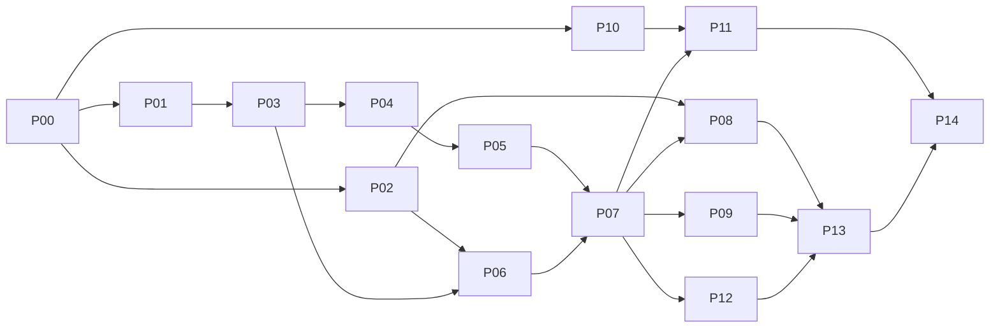

# SDLC implementation plan

Prepared 2026-11-17 against `721367ba220dc2384c83ee1c33b3a38bdf702e5b`. This is the execution specification for the [research spike](sdlc-research-and-plan.md), covering the supplied report, workflow simplification, verification, cost control, Chef in both providers, and repository cleanup. It authorizes no claim that implementation or evaluation has already passed. The research document remains the source register and audit history; this document owns the implementation sequence.

Planning review: the `intake-curmudgeon` review returned “no more questions” after ownership, CI correlation, cleanup scope, and completion criteria were clarified. Document formatting and the eight process-document reference checks passed. These are checks of the plan, not implementation evidence.

## Outcome and boundaries

Ship a smaller delivery workflow in which each accepted outcome has independently checkable evidence, each expensive action has an owner and a reason, interrupted work resumes without repeating completed side effects, and cost is measured across the entire attempt. Keep the existing Bun scripts, Turborepo graph, worktrees, test lanes, and provider runtimes. Make Chef a thin way to select and execute those capabilities.

The implementation includes driving every reused open pull request through its actual completion boundary. It includes repository-wide reachability and test-portfolio inventories, removal of the seven named cleanup candidates when proven orphaned, and executable protections against recurrence. Additional findings are delivered as a classified inventory; their deletion is outside this bounded implementation, not an automatically expanding assignment. It includes a bounded comparison of the current and simplified Chef routes. It does not introduce a distributed agent platform, a database service, a custom context compactor, predictive machine learning for test selection, a new test framework, a new product feature, or a package publication. The private mirror repository and unrelated global agent tooling remain outside this change.

“Works” means the accepted behaviors and declared risks have passed their specified oracles on the relevant inputs and artifact. It is not a proof over every possible input. Report merged, verified, installed, deployed, and closed separately; none substitutes for another.

## Decisions this plan makes

| Concern | Implementation decision | Observable enforcement |
| --- | --- | --- |
| Small changes | One implementation owner uses the same contracts and gates without a coordinator/worker handoff. | A direct-route scenario completes without spawning an implementation subagent. |
| Larger work | At most two implementation workers, one coordinator, one retained primary reviewer used when capacity permits. Shared interfaces have one owner. | Dispatch records and host admission refuse excess workers; no nested delegation. |
| Models | Use the least expensive available profile that passes the same outcome checks; never infer the actual model from a routing label. | Record requested and observed settings separately; unavailable telemetry is explicit. No stronger model escalation without a named failed boundary. |
| Publication | Commit per issue; publish one stable candidate per cohesive batch. An explicit recovery checkpoint is allowed and labeled separately. | One candidate identity and one coalesced verification request; checkpoint pushes do not request redundant full verification. |
| Local feedback | Direct regressions, formatting, root guards, relevant lint and types remain local. | Focused checks record every step, including a step not run because resources are unavailable. A pending step is not a pass. |
| Candidate verification | Required affected behavior and risk checks gate verification. Sensitive changes gate integration; all required obligations gate issue completion. | A machine-readable verification plan is evaluated against independently collected results. |
| Ordinary integration | Preserve optional pull requests and the reversible-code route. A narrowly scoped change may integrate while asynchronous obligations remain pending, but cannot be declared verified or Done. | The state record retains outstanding obligations and a responsible coordinator after merge. |
| Automatic deployment | A change that can deploy automatically has its required verification before integration. | Deployment reachability is a risk override; there is no “verify later” path to an automatically deployed artifact. |
| Release | Installed artifact and, where required, published/deployed artifact evidence gates delivery. | Source revision, artifact digest, target, configuration identity, and producer provenance are checked. |
| Existing failures | Compare with the exact base under equivalent conditions. Historical CI matches are diagnostic clues. | A matching test name does not turn a failure into a pass or satisfy a release obligation. |
| Ownership | Support one host using the existing lock primitive and persisted ownership generations. | Acquisition, cancellation, and consequential local transitions serialize; stale generations cannot publish through Chef. Multi-host exclusion is explicitly unsupported. |
| State | Extend the existing execution record with a versioned JSON snapshot, atomic replacement under a dedicated lock, and a bounded transition history. Keep raw evidence in artifacts. | Crash/restart tests prove recovery. No new database, daemon, or general workflow engine. |
| Reporting | Render human reports from validated records. | Ten Markdown headings are no longer a completion gate. |
| Tests | Retain unique behavioral boundaries; remove obsolete or redundant assertions only with a documented replacement oracle. | The retirement inventory names retained coverage and a fault it detects. |
| Regressions | Put cheap deterministic checks in existing CI and use paid agent evaluations only for relevant changes. | Broken-command, disconnected-guard, stale-owner, false-evidence, and empty-test fixtures fail. |

These are proposed policy changes, especially the distinction between asynchronous worker return and completed delivery. Update the project rules and both provider routes together in P08. Do not quietly claim they are already enforced by the baseline.

## Execution organization

The coordinator owns the current execution record, dependencies, Linear writes if tracking is subsequently created, candidate acceptance, integration, and final closeout. Worker A owns Chef contracts, state, and provider behavior. Worker B owns verification selection, CI, and repository hygiene. File ownership in the table is a reservation, not permission to edit another worker's unmerged branch. A worker returns an interface mismatch to the owning worker through the coordinator.

Use `chef-worker` for implementation dispatches and `chef-reviewer` for the primary Chef review. Give each a self-contained brief with `fork_turns: "none"`. Reuse the same owner and reviewer through corrections. A design reviewer is required for the applicable portions of reused PR #1157; a security reviewer is required for changed credential, untrusted-result, path, or external-command boundaries. Run specialists sequentially within the host's three-session limit rather than adding a permanent reviewer swarm. Do not override a fixed agent model through a flag the runtime ignores; P00 verifies capability and P08 aligns the installed role with the selected profile.

| Unit | Outcome | Owner | Dependencies | Primary files or surface | Integration boundary |
| --- | --- | --- | --- | --- | --- |
| P00 | Reproducible baseline and tested premises | Coordinator with one worker for probes | None | Existing execution record and scratch evidence | Recorded baseline; no source change required |
| P01 | Reused PR #1157 fully delivered | Existing implementation owner; coordinator accountable | P00 snapshot | Entire current PR diff, COR-2507, COR-2508 | Merged PR, verified obligations, tracker read-back |
| P02 | Complete cost and outcome accounting | Worker B | P00 | Transcript usage and execution-record fields | Merged accounting change and frozen evaluation manifest |
| P03 | One assignment and verification contract | Worker A | P01 | Brief generation, contract validation, design mapping | Reviewed contract fixtures and merged implementation |
| P04 | Exclusive ownership and recoverable state | Worker A | P03 | Linear claims, host locks, execution state | Merged infrastructure PR |
| P05 | Evidence-backed verification and closeout | Worker A | P04 | Delivery, merge paths, delivery ledger, evidence validation | Merged infrastructure PR |
| P06 | Audited selection and cache reuse | Worker B | P02, P03 | Affected tests, focused checks, task-cache tests | Merged selector change with shadow results |
| P07 | CI produces complete candidate evidence | Worker B | P05, P06 | GitHub workflows and evidence collection | Merged infrastructure PR and observed workflow run |
| P08 | Smaller Chef with equivalent provider behavior | Worker A | P02, P05, P07 | Shared skill, both role pairs, Claude workflows, project guidance | Merged change and fresh-provider smoke results |
| P09 | Stronger oracles and justified test retirement | Worker B | P04, P05, P07 | Owning tests, workflow scenarios, test-portfolio inventory | Merged tests and mutation/control evidence |
| P10 | Demonstrated orphan files removed | Worker B | P00 | Five named cleanup candidates and references | Merged cleanup branch |
| P11 | Repository reachability and guard wiring enforced | Worker B | P07, P10 | Entrypoint configuration, root scripts, guard tests | Merged infrastructure PR and classified inventory |
| P12 | Artifact verification participates in delivery | Worker A | P05, P07 | Interborough release verification and deployment reachability | Merged gate integration and installed-artifact receipt |
| P13 | Measured Chef routing recommendation | Coordinator; workers execute isolated trials | P08, P09, P12 | Frozen tasks, trial records, outcome/cost report | Completed bounded experiment, no product changes from trials |
| P14 | Adopted workflow and no outstanding delivery obligations | Coordinator and primary reviewer | P01–P13 | Integrated execution record, documentation, all delivered heads | Final integrated verification and program closeout |

Run P01 and P02 concurrently after the baseline snapshot; P10 can occupy an otherwise idle Worker B slot. After P03 freezes the shared contract, P04/P05 and P06 can proceed in parallel. P07 is their synchronization point. P08 and P09 can then run in parallel; serialize P11 with other root manifest/workflow edits and serialize P12 with other delivery edits. P13 follows adoption candidates, and P14 closes the integrated result. The dependency graph permits parallel work without requiring both slots to remain occupied.



The table is authoritative where the diagram omits a transitive edge. Each unit closes independently when its own boundary is reached. An integrated change with pending required evidence remains open. No task consists of “decide the architecture” or an unanswered product question.

## Common worker and delivery contract

Every brief contains the unit ID; source/base revision; read-first files; owned paths; explicit exclusions; acceptance IDs; delivery boundary; verification plan; scratch directory; current claim generation; requested provider profile; required review; and predecessor evidence. It also names shared-file reservations. Do not ask a lighter worker to reconstruct the whole research report or session.

The coordinator records concrete values for `SDLC_BASE_SHA`, `SDLC_HEAD_SHA`, `SDLC_BRANCH`, `SDLC_RUN_ID`, and, when relevant, `SDLC_PR` in each brief. Commands below use those variables, not floating assumptions about `main`. Existing commands have been inspected in source. All runtime premises are classified as `assumed` until P00 records a passing probe; source inspection is not a probe. Commands naming a new `./scripts/chef/` test or entrypoint are interface requirements for the owning unit, not commands available at the baseline. New tests belong beside their implementation; process-starting tests use `.integration.test.ts`.

At worktree start, run `bun install --frozen-lockfile`. Before publishing, run the unit's direct tests, then `with-turborepo-cache bun scripts/chef/focused-checks.ts --json`, then `bun scripts/chef/revert-check.ts`, and inspect `git diff --name-only origin/main...HEAD`. Record exits rather than grepping for reassuring output. A formatting or documentation change gets only checks that can observe it; do not run the whole monorepo because this plan is large.

Root tooling, ownership, concurrency, verification selection, workflow changes, and one-way doors require a pull request and the stable-candidate full CI run. Before P07, use `gh workflow run main.yml --ref "$SDLC_BRANCH"` once when that obligation is not already covered by the same candidate's run; record the dispatch time and discover the matching workflow/event/head through the provider. Ambiguity stays pending until inspected, never selecting a convenient green run. After P07, use its request-key dispatch and discovery protocol. `gh run view "$SDLC_RUN_ID" --repo stevekinney/corvidae --json headSha,event,status,conclusion,url,jobs` retrieves the result. Dispatch success is not test success. During bootstrap, the coordinator performs the checks that P05/P07 will later enforce.

A verified manual `main.yml` run can satisfy the plan's full-suite obligation. It cannot substitute for a separately required PR check. The existing `pull-request.yml` workflow's `pull_request` event and P07's aggregate supply PR-event evidence; the coordinator also reads GitHub's actual required check contexts and confirms their conclusions at the current PR candidate. Keep these two obligation types distinct even when they execute similar commands.

For every pull request, freshly read all checks, bot completion, every paginated review thread, and conflicts against fetched `origin/main`. Review comments belong on affected lines/files. Fix findings through the implementation owner, run only invalidated checks, and review the corrected diff. Fetch once more immediately before the serialized merge. Verify the merged commit and final delivery obligations afterward. A three-round review limit is a reassessment boundary, never permission to merge a demonstrated blocker. Two unsuccessful repairs to the same defect trigger causal reassessment across all owners and resumed sessions.

No new timers, retry allowances, disabled assertions, coverage reductions, hook bypasses, or blanket ignores may be used to make this program pass. Record a real blocker and its failing boundary. Preserve independently completed units. A pool-busy local test remains pending and is satisfied later by equivalent trusted CI evidence; an agent does not spend its context waiting for a resource reservation.

## Work units

### P00: Freeze the baseline and verify mechanisms

Outcome: later workers have a source snapshot, an overlap inventory, and tested premises instead of assumptions about tools and policy. This is a read-only baseline plus disposable probes, not a new telemetry platform.

Acceptance:

- P00-AC1: Record repository head, status, pinned and installed Bun versions, relevant lock/configuration digests, actual provider versions and available role/model controls. Preserve uncommitted work. Capture current shared Chef, both role pairs, workflows, and generated briefs before simplification.
- P00-AC2: Record the open-PR inventory and existing issue ownership. PR #1157 is explicitly assigned to P01. Any additional open PR whose code this program reuses is added to the same completion register with an owner, head, scope, and closure criteria before becoming a dependency.
- P00-AC3: Mark every premise as `verified by probe (<evidence path>)` or `assumed`. Run disposable probes for JSON brief output, injected Linear-client behavior, custom lock directories, workflow arguments, transcript fields, test inventory output, task-cache fingerprints, and the existing installed-release receipt. Source inspection alone is not labeled a runtime probe.
- P00-AC4: A deterministic fake-client probe reproduces the read/write/read-back claim interleaving; no live Linear claim is acquired for this experiment. Identify exactly which lock and state hooks P04 can reuse.
- P00-AC5: Snapshot the latest ten completed `main.yml` runs available at the baseline plus the current #1157 candidate runs and available usage, without claiming they are a controlled Chef baseline. Record missing artifacts/history explicitly. Each dependent unit's required premises have passed before dispatch; a failed probe updates the concrete implementation mechanism, not the acceptance outcome.

Verification commands:

```bash
git status --porcelain
git rev-parse HEAD
git worktree list --porcelain
bun --version
gh pr list --repo stevekinney/corvidae --state open --json number,title,headRefName,headRefOid,url
bun scripts/bun-test.ts scripts/chef/brief.test.ts scripts/chef/linear.test.ts scripts/chef/transcript-usage.test.ts
```

Store probe source, command, exit, and observation under the run's assigned scratch directory. Run each probe through the existing Bun test wrapper. No paid agent trial is part of P00.

### P01: Drive reused pull requests to completion

Outcome: the program incorporates completed upstream work rather than depending indefinitely on an open branch.

The initial register contains [PR #1157](https://github.com/stevekinney/corvidae/pull/1157), head `70007b10229003e17d24d2eaf25630078d15d8ef` when inspected, branch `chef/sdlc-token-efficiency`, linked to COR-2507 and COR-2508. It is open. Its scope includes CI comparison, worker return behavior, review handoffs, lock-error handling, test-pool changes, Interborough host/browser tests, and snapshot updates. Its self-reported validation is not independent evidence for this plan. Re-read the full current diff before assigning corrections.

Before dispatch, the coordinator records the active owner's agent/session identity, correction channel, branch/worktree location, and handoff state from current claims and worktree/session inspection. The coordinator owns integration under the user's explicit instruction to complete reused PRs. If an active owner cannot be reached, P01 remains blocked on that ownership boundary while independent units proceed. If inspection confirms the owner is inactive, assign Worker A a new owned worktree from the PR head and record the takeover; preserve the old worktree, update the same PR branch with normal fast-forward pushes, and never create a duplicate PR or force-push over new work.

Acceptance:

- P01-AC1: Coordinate with the existing owner and preserve their worktree and changes. Record who owns corrections and who performs integration. Do not open a duplicate PR or cherry-pick an unfinished branch and abandon its lifecycle.
- P01-AC2: Read linked issue criteria and the complete current diff. All criteria are either demonstrated by the final head or corrected. Inspect snapshot changes against the agreed behavior/design and run applicable design review; do not approve image updates because tests became green.
- P01-AC3: Required checks and review bots are terminal and passing, all review threads are answered and resolved after pagination, and the reviewed head is conflict-free against the current base. Any matching failure on `main` is recorded as a diagnostic classification with exact control evidence; it is not silently converted to a successful required check.
- P01-AC4: Squash-merge through the existing authorized delivery route, read back the merge commit, complete remaining acceptance evidence, and close COR-2507/COR-2508 only when their criteria pass. Record the completion evidence and issue state read-back.
- P01-AC5: Reconcile this plan against the merged implementation. Retain solved behavior, update concrete file ownership, and remove duplicate changes from later briefs while retaining their outcome requirements. Every newly reused PR gets the same lifecycle before P14 can close.

Verification commands, with the head refreshed at execution:

```bash
gh pr view 1157 --repo stevekinney/corvidae --json state,headRefOid,baseRefOid,mergeable,statusCheckRollup,mergedAt,mergeCommit,url
bun scripts/chef/review-threads.ts list stevekinney/corvidae 1157 --unresolved --json
bun scripts/bun-test.ts ./scripts/chef/ci-compare.test.ts scripts/chef/brief.test.ts scripts/chef/focused-checks.test.ts scripts/chef/deliver.test.ts ./scripts/check-swallowed-catches.test.ts
bun scripts/bun-test.ts scripts/bun-test-pool.integration.test.ts
```

The two new test paths in that command come from #1157 and are run from its final branch, not the old baseline. Use the existing design-capture workflow and design-review skill for its affected screens. Read Linear through its connector; the coordinator alone writes completion. The exact live validation inventory can grow with the PR's actual diff, and remains owned by P01.

### P02: Account for the whole outcome and freeze the evaluation bank

Outcome: a report can explain the cost of one accepted outcome, including failed attempts and resumed workers.

Scope: extend `scripts/chef/transcript-usage.ts`, its tests, and the existing execution-record format. Add an outcome identifier and attempt links rather than a second transcript parser. Prepare ten small task snapshots, two in each family: local regression, cross-workspace contract, concurrency, agreed UI behavior, and interrupted delivery. Keep one of each pair held out from instruction tuning. Historical bugs and synthetic workflow fixtures are acceptable when their oracle is independently specified.

Acceptance:

- P02-AC1: Root and child attempts, corrections, restarts, cached input, uncached input, cache writes where exposed, and output are accounted for without duplicate counting. Missing or malformed usage does not become zero usage.
- P02-AC2: Every outcome record includes source/task identity, provider, requested/observed model and effort or explicit unknown, policy revision, completed criteria, reviewer effort, human interventions, verification time, and attempts. Prices are supplied as dated input; absent prices produce tokens and unknown cost.
- P02-AC3: An explicit user allowance, when present, is cumulative across the run. Dispatch reservations and actual spending survive resume. A soft limit stops new dispatch/escalation; a hard in-flight limit is claimed only when a verified runtime control enforces it. With no numeric allowance, do not invent one or report account-wide usage as this run's spend.
- P02-AC4: Reports separate delivery throughput, outcome success, escaped seeded defects, total cost, elapsed verification time, and human intervention. They do not optimize changed-line count or cheap failed attempts.
- P02-AC5: The task bank is frozen with base revisions, inputs, acceptance oracles, permitted paths, delivery boundaries, held-out flags, and a reproducible order seed before P08 changes instruction text. Baseline policy snapshots remain immutable.

Verification:

```bash
bun scripts/bun-test.ts scripts/chef/transcript-usage.test.ts ./scripts/chef/outcome-accounting.test.ts
bun scripts/chef/transcript-usage.ts --json "$SDLC_TRANSCRIPT_PATH"
```

The brief supplies a real transcript fixture/path and an expected total. Include fixtures for cumulative Codex counters, Claude child transcripts, duplicate paths, unknown models, missing usage, cancellation, and resumed attempts. No paid evaluation is required to merge P02.

### P03: Define one machine-readable assignment and verification contract

Outcome: both provider routes consume the same accepted scope and obligations without reinterpreting Markdown.

Scope: extend `scripts/chef/brief.ts` and `scripts/chef/design-ledger.ts`; place small contract types and boundary validators beside the owning scripts. Use three connected records—assignment, verification plan, execution/evidence—with nested fields rather than nine independent schema frameworks. The existing Markdown brief becomes a rendering of the assignment.

Acceptance:

- P03-AC1: Assignments contain stable criterion IDs, revision, repository/base, owned paths, exclusions, dependencies, source references and access status, design-row mapping when applicable, requested delivery boundary, and allowed consequential actions. External source text cannot grant additional execution authority.
- P03-AC2: JSON brief output includes structured blockers, unreadable dependencies, claim status, scratch path, and assignment identity. An invalid or blocked assignment launches no worker. A batch has ordered members and per-member acceptance; completing one member does not close another.
- P03-AC3: Each verification obligation names its criterion/risk, exact command or provider job, expected inventory, relevant inputs, environment/toolchain, execution boundary, producer, and selection reason. An empty plan is accepted only for an explicitly classified no-behavior change with required static/documentation checks.
- P03-AC4: The risk map explicitly covers root scripts, shared configuration, transitive consumers, dynamic entrypoints, authorization, persistence/protocols, installed artifacts, shared UI/design, and automatic deployment. Unknown ownership broadens the plan. Sensitive and automatically deployed changes require evidence before integration.
- P03-AC5: Assignment, context, and policy changes invalidate their dependent evidence. Relevant source references are pinned or hashed and accessible; missing required context blocks dispatch. Ordinary workers receive the smallest relevant reference set, not the full research archive.

Verification:

```bash
bun scripts/bun-test.ts scripts/chef/brief.test.ts scripts/chef/design-ledger.test.ts ./scripts/chef/verification-plan.test.ts
bun scripts/chef/brief.ts "$SDLC_ISSUE" --run "$SDLC_CLAIM_RUN" --json
```

The live brief command is read-only and uses an already assigned issue/run. Tests use injected clients. Freeze the record interface before P04 and P06 run concurrently; contract changes return to this owner.

### P04: Make claims and resume state reliable on one host

Outcome: two local coordinators cannot both receive dispatch authority for the same resource, and a restarted coordinator knows what happened.

Scope: existing `scripts/chef/linear.ts`, lock primitives, and a dedicated execution-state module. Store one versioned run snapshot and resource ownership records in the canonical repository's existing `tmp/chef` state area; workers do not mutate coordinator-owned state. Use dedicated lock directories, atomic file replacement, and explicit revision/generation checks. Never hold the heavyweight test lock while waiting on a remote API.

Acceptance:

- P04-AC1: Deterministic concurrent-claim tests allow at most one dispatch grant for an issue/project. A live foreign Linear claim is refused. The local lock protects acquisition and state update; a comment read-back is not presented as atomic exclusion.
- P04-AC2: Authority includes run ID, owner identity, generation, and resource. Expiration or cancellation does not itself stop a process; it revokes subsequent Chef transition permission. Old completions cannot release a new owner's reservation or publish through the coordinator.
- P04-AC3: Dispatch, remote mutation intent, observed remote result, pending closeout, and next action survive restart. A crash before/after each persistence boundary yields either the previous complete snapshot or the next complete snapshot. Corruption is surfaced, not treated as an empty successful run.
- P04-AC4: Reconciliation inspects current provider/Git state before repeating an ambiguous operation. The same operation identifier resumes its original action. Unknown remote outcome stays unresolved until inspected; no “exactly once” claim is made for external APIs.
- P04-AC5: Cancellation and resume have behavioral tests. Cleanup touches only owned processes/worktrees and preserves unfamiliar or dirty worktrees. Multi-host acquisition is rejected or explicitly outside the supported authority boundary; local fencing is never advertised as global fencing.

Verification:

```bash
bun scripts/bun-test.ts scripts/chef/linear.test.ts scripts/host-sessions-model.test.ts ./scripts/chef/execution-state.test.ts
bun scripts/bun-test.ts ./scripts/chef/execution-state.integration.test.ts scripts/chef/workers.integration.test.ts
```

The new integration test uses subprocesses and a disposable custom state/lock directory. Include crash injection, stale generation, PID reuse assumptions, duplicate cancellation, concurrent acquisition, and a provider write whose response is lost. This unit requires an infrastructure PR and full candidate CI.

### P05: Validate evidence before verification, merge, and closeout

Outcome: a formatted worker report cannot falsely establish success, and partial external completion resumes safely.

Scope: `scripts/chef/deliver.ts`, `scripts/chef/direct-merge.ts`, `scripts/chef/merge-gate.ts`, `scripts/chef/delivery-ledger.ts`, and the evidence validator. Preserve the delivered-head ledger's worktree-cleanup purpose; it is not the authority for whether all acceptance criteria passed.

Acceptance:

- P05-AC1: Worker results are claims. The coordinator validates local exits/artifacts it collected or fetches CI identity and result through the authenticated provider. A JSON field saying `producer: ci`, an arbitrary URL, or a worker-edited receipt is insufficient. Inputs and artifact paths are validated before file reads or external commands.
- P05-AC2: Evidence records distinguish pass, reused-pass, fail, pending, canceled, skipped, and not-applicable. Missing/wrong-revision/wrong-environment results, unexpectedly empty test inventories, and absent required artifacts cannot satisfy obligations. A successful process exit does not override a failed assertion in a structured report.
- P05-AC3: Evidence reuse checks relevant task inputs, command/configuration, toolchain/environment, and intact artifacts. Record source SHA for provenance without putting the whole SHA into every task cache key. Dirty-tree evidence records actual content identity and cannot masquerade as clean-HEAD evidence.
- P05-AC4: Both merge paths check current authority, reviewed head, expected integration tree, conflicts, and the plan's pre-integration obligations. A changed base/interface invalidates affected evidence; an unrelated change preserves valid reusable results. Sensitive changes cannot take an unverified direct-merge shortcut.
- P05-AC5: Merge success followed by tracker, ledger, or branch-cleanup failure resumes only the unfinished side effect. Repeated delivery does not merge twice, duplicate completion comments, or close unmet issues. A batch closes individually satisfied members and preserves remaining release/program gates.
- P05-AC6: Markdown completion reports are rendered from records. Remove the heading-count gate only after its acceptance information is represented and validated. A missing installed/deployed artifact keeps the corresponding obligation open even when integration succeeded.

Verification:

```bash
bun scripts/bun-test.ts scripts/chef/deliver.test.ts ./scripts/chef/evidence.test.ts
bun scripts/bun-test.ts scripts/chef/direct-merge.integration.test.ts scripts/chef/merge-gate.integration.test.ts ./scripts/chef/delivery-recovery.integration.test.ts
```

Use injected provider responses and disposable Git remotes to cover changed heads, multiple thread pages, canceled jobs, ambiguous merge responses, closeout failure, tampered receipts, and corrupted artifacts. Require primary review and security review of the trust boundary. Do not add a general credential store or accept secrets in receipts.

### P06: Audit selection and reuse against the existing full suite

Outcome: fewer redundant checks run without losing known dependency and boundary coverage.

Scope: the existing `scripts/affected-tests.ts`, `scripts/chef/focused-checks.ts`, their tests, and `scripts/task-cache.integration.test.ts`. Extend the existing selector; do not create another graph or an ML model.

Acceptance:

- P06-AC1: Explain output maps each changed input to selected obligations and gives explicit reasons for exclusions. Fixtures cover root-only changes, workspace dependencies, transitive consumers, shared TypeScript/lint configuration, manifests/lockfile, dynamic/manual entrypoints, browser fixtures, and unknown paths.
- P06-AC2: Focused checks remain inexpensive direct feedback. Their report names what they do not cover and feeds pending broader obligations into the plan. A test queued but not executed is not reported as passing.
- P06-AC3: Cache tests demonstrate that relevant input/tool/environment changes invalidate and unrelated changes reuse. Artifact restoration is verified. Force flags cannot silently alter nested test semantics. Preserve direct-source libraries and current dependency declarations.
- P06-AC4: Replay the selector over the frozen baseline CI sample and program candidates in shadow. Record selected tests, full-run failures, omitted failures, and input identity. Every known relevant omitted failure is fixed or conservatively selected before the selection rule becomes authoritative; unavailable full evidence is inconclusive, never zero misses.
- P06-AC5: Keep the existing full CI coverage as the audit reference. Do not reduce full-suite scope or add a new periodic paid evaluation to obtain savings. Coalesce duplicate requests for identical obligations instead.

Verification:

```bash
bun scripts/affected-tests.ts --explain --base "$SDLC_BASE_SHA"
bun scripts/bun-test.ts scripts/affected-tests.test.ts scripts/chef/focused-checks.test.ts ./scripts/chef/verification-plan.test.ts
bun scripts/bun-test.ts scripts/task-cache.integration.test.ts
```

Deliver the shadow comparison as machine-readable evidence plus a short summary. The pass condition is zero unresolved demonstrated selection misses, not a claim of perfect recall on unseen changes.

### P07: Make CI evidence complete and waits inexpensive

Outcome: the coordinator can tell whether every planned obligation ran for the intended candidate without an agent repeatedly reading unchanged logs.

Scope: existing `main.yml`, `pull-request.yml`, `targeted-checks.yml`, reusable browser workflows, and a small collector/aggregate validator in the Chef scripts directory. Reuse existing JUnit and artifact production.

Acceptance:

- P07-AC1: Every verification request is identified by repository, candidate/base or integration-tree identity, and verification-plan digest. Repeating that request reuses its run rather than dispatching another. Record GitHub event, head, attempt, job inventory, and workflow revision.
- P07-AC2: An aggregate job runs even when prerequisites fail/skip and checks the expected obligation inventory. Missing required jobs, reports, tests, or artifacts fail aggregation. Legitimate not-applicable browser jobs are explicit in the plan. Required evidence upload failure is not ignored; optional diagnostic uploads may remain advisory.
- P07-AC3: Pull-request evidence is produced by the pull-request event or another verified supported check mechanism. A manual workflow dispatch is not assumed to satisfy a PR-required context. Reconcile PR merge-ref and head/base identities explicitly.
- P07-AC4: Superseded read-only candidate checks can be canceled and their evidence is marked canceled. Merge, publication, deployment, and closeout operations are not subject to blanket cancel-in-progress behavior. A pending newest request cannot erase evidence for a completed candidate.
- P07-AC5: One background/provider wait owns CI completion. It stores run IDs and emits a compact terminal summary; workers return promptly. Raw logs are downloaded only for a concrete failure question. Provider unavailability produces pending/unknown, not success.
- P07-AC6: Both Chef merge routes enforce their plan through P05. Record the actual GitHub protection configuration and any deliberate advisory checks; do not claim administrator-proof enforcement or enable a rule that accidentally bans the supported direct route. Fixture tests prove a green unrelated workflow cannot satisfy a required obligation.

The dispatch protocol hashes repository, base, candidate, verification-plan digest, and workflow revision into a request key. Under a dedicated request lock, persist intent before dispatch and reuse an already recorded run. Add `verification_request`, `verification_plan`, and `verification_base` inputs to manual verification. Put the request key in `run-name`; GitHub documents [input expressions in run names](https://docs.github.com/en/actions/reference/workflows-and-actions/workflow-syntax#run-name). Read the resulting run through the authenticated [workflow-runs API](https://docs.github.com/en/rest/actions/workflow-runs#list-workflow-runs-for-a-workflow), filtering workflow/event/head and matching its displayed request key. Validate its actual source and emitted plan digest before binding its run ID.

An absent result after an ambiguous dispatch response stays unresolved; do not immediately dispatch again. Multiple matches are all recorded: equivalent pending read-only duplicates can be canceled, but conflicting conclusions require investigation rather than choosing the green one. The run ID and attempt become the wait handle. A lost notification resumes by reading that handle. PR-triggered runs bind through the PR/head/base and aggregate's plan digest, without manufacturing a manual-dispatch PR status. Manual runs satisfy only their declared full-suite or targeted obligations; required PR contexts must independently pass.

Verification:

```bash
bun scripts/bun-test.ts ./scripts/chef/ci-evidence.test.ts ./scripts/chef/verification-plan.test.ts scripts/chef/main-ci.test.ts
bun scripts/bun-test.ts ./scripts/chef/ci-evidence.integration.test.ts
gh workflow run main.yml --ref "$SDLC_BRANCH" -f verification_request="$SDLC_REQUEST_KEY" -f verification_plan="$SDLC_PLAN_DIGEST" -f verification_base="$SDLC_BASE_SHA"
gh api --method GET repos/stevekinney/corvidae/actions/workflows/main.yml/runs -f event=workflow_dispatch -f head_sha="$SDLC_HEAD_SHA" --paginate
gh run view "$SDLC_RUN_ID" --repo stevekinney/corvidae --json headSha,event,status,conclusion,url,jobs
```

Integration fixtures cover missing/empty reports, wrong head, retry attempt, dependency skip, artifact upload failure, duplicate dispatch, and event loss. Observe one real branch run and its aggregate; a YAML parse alone is insufficient. This unit requires a PR and review of the credential/permissions boundary.

### P08: Simplify Chef and align Codex and Claude Code

Outcome: direct and coordinated execution use one concise policy and identical outcome semantics in both providers.

Scope: `.agents/skills/chef/SKILL.md`, its references, both Chef worker/reviewer definitions, `.claude/workflows/deliver-issue.js`, `.claude/workflows/answer-threads.js`, `scripts/chef/brief.ts`, and project `AGENTS.md`. Preserve the two skill symlinks. Inspect the skill/agent authoring instructions before making these changes. Global provider instructions change only if this implementation introduces shared global behavior; then update both provider files and record that separately from repository delivery.

Acceptance:

- P08-AC1: The skill starts with direct-versus-coordinated routing and names five responsibilities: accept, route, implement, verify/review, integrate/reconcile. It links mechanics rather than repeating them. Provider references contain only provider differences. No 300-line minimum, universal context-cost estimate, or contradictory push/scope rule remains.
- P08-AC2: Both worker roles say one cohesive assignment, optionally an ordered batch; preserve bounded ownership and one push per stable candidate. The brief is the canonical charter source. Provider definitions contain only necessary role/capability differences instead of duplicated delivery paragraphs.
- P08-AC3: Brief preparation uses no LLM. Run the deterministic brief command in the coordinator and pass validated paths/records into the Claude workflow's existing arguments; do not assume its JavaScript runtime exposes an undocumented shell primitive. Blocked preparation dispatches zero workers.
- P08-AC4: Codex and Claude scenarios agree on blockers, candidate identity, corrections, direct/PR routes, partial completion, cancellation, evidence, and final status. Corrections retain issue/contract context and cumulative failure counts. Existing one-correction workflow behavior must report one correction accurately, not mislabel it as two failed corrections.
- P08-AC5: Requested/observed profiles are recorded, unsupported overrides are visible, and the selected worker profile is actually loaded in a fresh runtime. Align routing prose with the observed role; do not call a profile cheaper without price/usage evidence. Read-only review uses a verified enforcement capability where available; where only tool/prose restriction exists, state that limitation and prevent automatic review write authority through the workflow.
- P08-AC6: Execute workflow functions through a mocked provider runtime, not just source-string matching. Preserve command/link/size checks and replace phrase-pinning assertions only after equivalent behavioral coverage exists. Measure effective dispatched prompt/reference bytes as well as the top-level skill size; no token-saving percentage is asserted from byte counts.

Verification:

```bash
bun scripts/bun-test.ts scripts/chef/brief.test.ts scripts/chef/workflows.test.ts scripts/chef/command-spellings.test.ts scripts/process-docs-budget.test.ts scripts/process-docs-references.test.ts scripts/process-docs-moved-rules.test.ts
bun scripts/bun-test.ts scripts/chef/workers.integration.test.ts
```

Run one fresh-provider deterministic dispatch smoke for each provider and record the resolved role/model and contract. These are capability checks, not the paid outcome comparison. If the runtime cannot enforce a property, document the narrower guarantee rather than inventing a setting.

### P09: Improve high-risk oracles and retire low-value tests deliberately

Outcome: tests detect the failure classes that matter, and each removed test has a defensible reason.

Scope: inventory repository test lanes and sampled execution-duration evidence; deeply review Chef workflow/ownership/delivery tests and process-documentation phrase tests. Application test removal is limited to demonstrated retired behavior or equivalent retained coverage, never a broad count-reduction target.

Acceptance:

- P09-AC1: Generate the repository-wide file/lane/entrypoint inventory mechanically and join available duration/flake observations. Do not spend agent calls writing a description of every unchanged test. Every proposed test change additionally records its behavior/boundary and disposition: retain, move lane, replace, or remove. Unknown runtime cost stays unknown. Process-starting and genuinely slow tests use existing isolated lanes; no performance assertion is disguised as a correctness deadline.
- P09-AC2: Every changed/removable assertion has an independent oracle from a contract, known-good example, invariant, or reference implementation. A test generated from current code is not accepted solely because that code passes it.
- P09-AC3: Deterministic event schedules cover exclusive claims, stale completion, duplicate registration, cancellation, retry identity, merge success/closeout failure, and cleanup after owner replacement. Replaying the same schedule gives the same result. Keep real process/filesystem/provider-boundary integration coverage where simulation cannot observe it.
- P09-AC4: Seed at least these named faults in isolated fixtures: remove the generation check, accept a wrong candidate head, count an empty test run as success, and repeat a completed merge after tracker failure. Each is killed by the intended assertion. Do not introduce a repository-wide mutation-score gate or a mutation service.
- P09-AC5: Each removed test names retired production behavior or retained tests that kill its relevant fault. Shared UI visual matrices, authorization, cold start, durability, and installed-artifact boundaries remain covered. Phrase assertions that only enforce wording are removed or narrowed after behavioral replacements pass.

Verification:

```bash
bun scripts/bun-test.ts scripts/host-sessions-model.test.ts scripts/chef/workflows.test.ts ./scripts/chef/delivery-model.test.ts scripts/process-docs-moved-rules.test.ts
bun scripts/bun-test.ts ./scripts/chef/delivery-recovery.integration.test.ts
```

Run seeded broken controls in disposable test fixtures and record expected nonzero exits separately from the repaired pass. Use existing CI artifacts for duration evidence first; do not force every cached suite to execute merely to rank tests.

### P10: Remove the demonstrated orphan candidates

Outcome: remove dead implementation and redundant declarations without removing supported manual commands.

Acceptance:

- P10-AC1: Recheck imports, package scripts, workflows, hooks, dynamic globs, documentation commands, published exports, and manual entrypoints at the candidate base for each of the five files in the research cleanup inventory.
- P10-AC2: Delete `components/cinder/scripts/component-conventions-hydration.ts`, `components/cinder/scripts/component-source-filter.ts`, `scripts/shiki-grammar-assets.ts`, its orphan test, and `scripts/test-deadlines.d.ts` only when that check still proves the recorded disposition. If a new consumer exists, retain the file and record the exact consumer; the criterion is justified classification, not forced deletion.
- P10-AC3: Under the pinned TypeScript version, extensionless and explicit `.ts` imports still resolve to the intended source after the declaration removal. Owning Cinder script checks still execute through their supported entrypoints.
- P10-AC4: Classify `components/cinder/scripts/export-names.ts` and `packages/weft/scripts/import-string-kv-sqlite-to-weft.ts` as supported manual tools with owner/purpose/invocation or proven orphans. Remove them only in the latter case. A historical name alone is not a supported entrypoint.
- P10-AC5: Historical research remains readable after deletion. Update the process-document reference checker with specifically justified historical documents, or rewrite historical mentions so they are not presented as runnable commands. Do not add blanket missing-path exceptions.

Verification:

```bash
rg -n 'component-conventions-hydration|component-source-filter|shiki-grammar-assets|test-deadlines|export-names|import-string-kv-sqlite-to-weft' --hidden --glob '!.git/**' --glob '!node_modules/**' .
with-turborepo-cache bun run typecheck:root
bun scripts/bun-test.ts scripts/process-docs-references.test.ts
with-turborepo-cache bun scripts/chef/focused-checks.ts --json
```

The `rg` output is an inspection input, not the sole dead-code proof. No broad worktree/process cleanup belongs to this unit. Its behavior changes are script cleanup, so a product design review is unnecessary unless the actual diff changes rendered behavior.

### P11: Add entrypoint-aware reachability and guard-wiring protection

Outcome: new orphan code and disconnected checks are detected by the normal workflow, with a complete classification of the repository baseline.

Scope: add pinned Knip through the repository's dependency/catalog policy; configure the existing workspaces and actual runtime/manual/test entrypoints. Use root `knip` as the command. Preserve `components/cinder/scripts/gate-wiring.ts` and its fixture tests. Add a root guard-wiring test for the root command graph, reusing existing parsing where its supported syntax fits; do not turn this into a general shell parser or parallel lint framework.

Acceptance:

- P11-AC1: Run the inventory over all workspace roots and root scripts. Every finding is assigned a live static/dynamic/manual entrypoint, an explicit public/export contract, or an orphan disposition. Tests that only keep an unused helper alive do not establish a production entrypoint.
- P11-AC2: P10 owns deletion of the five strong candidates and the two manual-command candidates. Other findings receive an explicit disposition, exact path/symbol, evidence, and suggested owner in the inventory, with an existing issue reference when one exists. Their deletion is outside this program. Uncertain externally consumed exports retain their evidence limits; do not claim they are proven live or silently hide them.
- P11-AC3: Configuration names legitimate fixtures, generated files, benchmarks, release tools, and manual commands with a reason. No repository-wide ignore or blanket workspace exemption makes the check pass. Existing accepted exceptions are visible, narrowly scoped, and cannot automatically cover new files.
- P11-AC4: A fixture introducing an unused module/export fails the unused-code check. A fixture disconnecting a required guard from the executable command graph fails the wiring check. Restoring each fixture passes. The ordinary CI path actually runs both checks.
- P11-AC5: The first classified baseline and raw inventory are retained. The enforced command fails on unclassified/new actionable findings; a production-only report and a test-inclusive report distinguish test-only reachability. If retained baseline findings exist, a small comparison command consumes Knip's JSON report and exact file/symbol/category baseline, prints those outstanding findings, and fails on additions or malformed reports. Do not raise `--max-issues`, use `--no-exit-code`, or mark dead files as entrypoints. Lockfile and pinned toolchain installation reproduce the result.

Verification:

```bash
bun install --frozen-lockfile
bun run knip
bun scripts/bun-test.ts ./scripts/unused-code.test.ts ./scripts/guard-wiring.test.ts
bun scripts/bun-test.ts components/cinder/scripts/gate-wiring.test.ts
bun run lint:guards
```

`bun run knip` and the two root test entrypoints are new deliverables; the Cinder test already exists. Knip's [JSON reporter](https://knip.dev/features/reporters#json) supplies machine-readable findings; its [CLI exit contract](https://knip.dev/reference/cli#--no-exit-code) distinguishes findings from tool failure. Test that distinction against the pinned installed version. Keep this unit serialized with other root manifest/workflow edits. It requires a PR and complete candidate CI.

### P12: Connect artifact checks to actual delivery obligations

Outcome: a release task cannot close on source tests or a merge alone, and automatic deployment cannot bypass required verification.

Scope: integrate the existing Interborough build/installed-release scripts with P03/P05 records. Audit the playground's existing Vercel ignore/build configuration for deployment reachability. Do not enable publishing, change product URLs, introduce a new release channel, or modify the private mirror.

Acceptance:

- P12-AC1: A local Interborough release-verification receipt carries the archive digest, manifest source revision, target architecture, installed executable, verification assertions, relevant configuration identity, and producer identity. The coordinator compares these with the accepted obligation rather than trusting worker prose.
- P12-AC2: Tampered archives, wrong source revisions, missing runtime assets, failed installation/startup, or a receipt for another target cannot satisfy the obligation. Keep clean-environment/no-global-Bun installed verification and its real browser/transport boundary.
- P12-AC3: A release-bound issue remains open when publication or deployment evidence is missing. Unit fixtures demonstrate this without publishing anything. Actual future publication must add authenticated registry/deployment read-back for that artifact; this plan does not fabricate a deployment receipt from an installed archive.
- P12-AC4: The deployment reachability map includes changes that cause playground deployment, including shared dependencies and deployment configuration. All their required behavior/build checks become pre-integration obligations. An unreadable deployment configuration is conservative, not permission to defer verification until after auto-deploy.
- P12-AC5: Build and verify one disposable, clean, pinned darwin-arm64 artifact on a supported host/runner, preserving its digest and receipt. Run it once for the stable candidate through coordinator-owned release verification, not once per worker. No publication occurs.

Verification:

```bash
bun scripts/bun-test.ts applications/interborough/scripts/test-installed-release-browser.test.ts ./scripts/chef/evidence.test.ts
bun scripts/bun-test.ts applications/interborough/scripts/build-release.integration.test.ts applications/interborough/scripts/test-installed-release.integration.test.ts applications/interborough/scripts/test-installed-release-lifecycle.integration.test.ts
bun applications/interborough/scripts/build-release.ts --version 0.0.0-sdlc-verification --outdir "$SDLC_RELEASE_DIRECTORY"
bun applications/interborough/scripts/test-installed-release.ts --archive "$SDLC_RELEASE_ARCHIVE" --evidence "$SDLC_RELEASE_EVIDENCE_DIRECTORY"
```

The brief supplies unused absolute output paths and the exact archive returned by the builder. Run the last two commands in a clean checkout of the pinned candidate with supported architecture and browser prerequisites, under coordinator ownership; implementation workers do not run local browser suites. Compare the receipt's source revision with `SDLC_HEAD_SHA`. Record the environment and exit, not only the archive's existence.

### P13: Run a bounded outcome-and-cost comparison

Outcome: adopt routing based on observed correctness and cost, while making the limits of the evidence explicit.

Use P02's frozen tasks, P08's two routes, and the same established worker/reviewer model configuration within each route comparison. First run deterministic scenarios across all five task families for both provider integrations. Then run at most eight agent trials: two small held-out tasks × current/simplified route × Codex/Claude. Choose the held-out local and cross-workspace tasks from the frozen manifest; use the concurrency, UI, and recovery fixtures for deterministic conformance. This is a pilot of workflow simplification, not a statistically powered equivalence study, a comparison of model tiers, or permission to spend until a preferred result appears. Its result cannot authorize an untested model downshift.

Acceptance:

- P13-AC1: Trial order is randomized with the recorded seed, tasks start from identical isolated snapshots, and neither route sees the other route's result. The final artifact is graded independently of its report using the same acceptance oracles. No trial branch is merged or published.
- P13-AC2: Include every trial, failure, repair, reviewer intervention, and known cost. Report after the first matched pair before expanding. Preserve any explicit user allowance; stop new trials at that boundary. A single failing boundary is diagnosed without rerunning unrelated completed trials.
- P13-AC3: Both routes pass the deterministic safety/recovery scenarios. A simplified-route-only correctness failure prevents adopting that route for the affected class until fixed. An actual defect gets its regression prevention in the owning unit, with only invalidated evidence repeated.
- P13-AC4: Report per-task/per-provider outcome and spend, aggregate spend per accepted outcome including failures, human intervention, and verification latency. Mark missing usage and avoid pooling different model configurations as if they were a controlled comparison. Do not quote a savings percentage from an incomplete pair.
- P13-AC5: Publish a decision table: retain direct mode for small independent tasks; retain coordinated mode where dependencies/parallelism justify it; adopt only profiles that meet the oracle. If pilot cost results are inconclusive, retain the established profile, keep the mechanically proven simplifications, and state that larger paid evaluation was not performed. No unbounded additional experiment is needed to finish this unit.

Verification:

```bash
bun scripts/bun-test.ts scripts/chef/workflows.test.ts ./scripts/chef/delivery-model.test.ts ./scripts/chef/outcome-accounting.test.ts
bun scripts/chef/transcript-usage.ts --json "$SDLC_TRIAL_TRANSCRIPT_DIRECTORY"
bun ./scripts/chef/evaluate-outcomes.ts --manifest "$SDLC_EVALUATION_MANIFEST" --results "$SDLC_TRIAL_RESULTS" --json
```

The new evaluator is a deterministic file/fixture grader and summarizer owned by this unit, not an agent launcher. It fails for missing trials that are claimed complete, mismatched snapshots, missing required oracle results, or invalid usage accounting. A budget stop is reported as an incomplete pilot, never dressed up as evidence of savings.

### P14: Adopt, verify the integrated result, and close the program

Outcome: the new workflow is the actual entrypoint, its protections run automatically, and no reused pull request or delivery obligation remains abandoned.

Acceptance:

- P14-AC1: Every mandatory P01–P13 criterion has passing evidence. A documented failed boundary never substitutes for a pass and leaves the program open. Diagnostic limitations may remain only where the criterion explicitly permits them, such as unavailable telemetry or an inconclusive cost verdict after the complete bounded pilot. The pull-request completion register has zero open entries, with merge and linked-issue read-back evidence.
- P14-AC2: Project instructions, shared Chef, both provider roles, generated briefs, workflow behavior, and command documentation agree. Removed process/test/script behavior is listed with its replacement or retirement evidence. Both provider skill symlinks resolve to the shared skill.
- P14-AC3: The normal CI path detects the seeded stale-command, unused-module, disconnected-guard, stale-owner, wrong-evidence, and empty-test cases. Paid agent trials are not added to every pull request. Changes to policy, provider role, dispatch behavior, or evidence contracts trigger the deterministic conformance checks.
- P14-AC4: Observe the full CI result for the final integrated revision, including required browser and isolated suites. Use existing valid task evidence when inputs match; add a build obligation for deployment-affecting changes and the installed-artifact receipt from P12. Report actual root and non-workspace coverage, not only a filtered workspace result.
- P14-AC5: Exercise one resumed closeout and one rejected stale completion through the supported entrypoint. The concise status report names candidate, state, satisfied/pending obligations, unresolved findings, cost, and next action without requiring raw transcript rereading.
- P14-AC6: Record the adoption verdict and rollback procedure. A regression restores the last known-good instruction/profile selection or conservatively broadens selection; it does not disable evidence/ownership checks. State-schema incompatibility fails with an actionable message and preserves the record. Clean up only this program's clean, delivered/retired trial worktrees after the required worktree audit.

Verification:

```bash
bun scripts/bun-test.ts scripts/process-docs-budget.test.ts scripts/process-docs-references.test.ts scripts/chef/command-spellings.test.ts scripts/chef/workflows.test.ts
bun run knip
bun run lint:guards
gh pr list --repo stevekinney/corvidae --state open --json number,title,headRefOid,url
gh run view "$SDLC_RUN_ID" --repo stevekinney/corvidae --json headSha,event,status,conclusion,url,jobs
agent-worktree-audit --quiet
```

Compare the open-PR output against the explicit completion register; unrelated open PRs do not block this program. Read the latest integrated head and CI together. The final report lists changed files, delivered outcomes, retained limitations, measured usage, and any explicit budget stop. If a required gate fails, the program stays open at that exact boundary.

## What stops, what remains, and how relapse is caught

| Stop doing | Replacement | Owner and prevention |
| --- | --- | --- |
| Agent calls to run a command and summarize blockers | Structured brief output and deterministic preparation | P03/P08; zero-worker-on-blocker scenario |
| Mandatory delegation for small cohesive work | Direct route with the same contracts/gates | P08/P13; route conformance and outcome comparison |
| Repeating full local suites after every repair | Direct feedback, stable-candidate CI, valid evidence reuse | P05–P07; plan/evidence checks |
| Keeping an LLM active while CI or a test pool is unchanged | Persisted pending obligation and one completion wait | P01/P07; no-duplicate-dispatch fixtures |
| Treating report headings, merges, or old green runs as completion | Independently checked criterion and artifact records | P05/P12; false-evidence fixtures |
| Re-reviewing the whole repository or rediscovering answered findings | One retained reviewer, affected diff, cumulative defect record | P08/P09; workflow scenarios and correction accounting |
| Maintaining contradictory provider policy copies | Shared charter plus narrow provider differences | P08; behavioral parity and command checks |
| Preserving tests solely because they exist | Explicit behavior/boundary inventory and fault-detecting replacement | P09; retirement evidence |
| Keeping scripts solely because their own tests import them | Entrypoint-aware production and test reachability | P10/P11; orphan fixture |
| Adding more prose after every failure | A causal regression, type constraint, or executable guard at the owning boundary | P04–P11; seeded recurrence checks |
| Claiming model savings from advertised tiers or token fragments | Actual profile and whole-outcome accounting | P02/P13; accounting fixtures |
| Depending on unfinished open pull requests | Named lifecycle owner through merge and closeout | P01/P14; completion-register check |

Retain root static checks, causal regression tests, affected consumer checks, real integration boundaries, applicable design review, the full CI audit, artifact installation/startup verification, serialized integration, and explicit escalation when a quality gate cannot be met. Streamlining removes repeated work and weak witnesses; it does not remove the unique observation that establishes a required behavior.

## Evidence, review, and rollout rules

The execution record is the index. Store raw logs, inventories, snapshots, task manifests, and trial outputs under the assigned run artifacts and attach durable CI artifacts where available. Each acceptance row points to an artifact, command/provider run, revision or input fingerprint, environment, exit/result, and reviewer when required. Secrets, unredacted credentials, and unrelated personal transcript content never enter committed artifacts.

Introduce records and validators with fixture tests before wiring them into dispatch/delivery. Run selection changes in shadow before granting omission authority. Keep provider policy on the current route until state/evidence/CI plumbing passes. Adopt the simplified route after its conformance checks and P13's bounded outcome comparison. This program uses the existing lighter implementation roles; it does not silently substitute an unevaluated model tier. Do not preserve an old runtime API merely to avoid changing internal callers—update the owning scripts together.

Required independent review concentrates on claim races, stale ownership, ambiguous remote side effects, evidence provenance, selection misses, and release identity. A reviewer must name a reachable failure and consequence. New speculative framework work, naming churn, line-count targets, and optional generalized hardening do not expand this program.

If execution tracking is created in Linear, the coordinator first clears the execution boundaries through `scope-work`/`intake-curmudgeon`, then creates COR issues with native dependencies matching the table and reads each write back. Reuse COR-2507/COR-2508 rather than duplicating them. Do not create decision tickets, or Linear tickets for unrelated user-global agent configuration. This file is already sufficient to dispatch implementation without creating a new tracking system.
