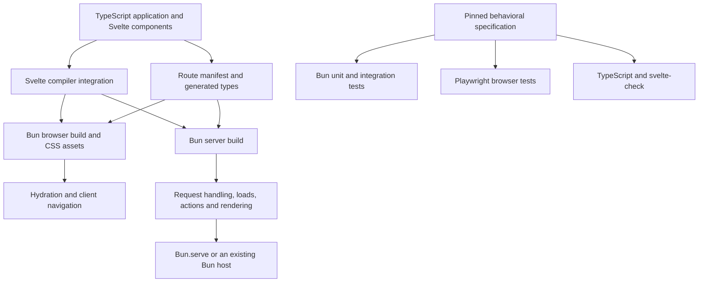
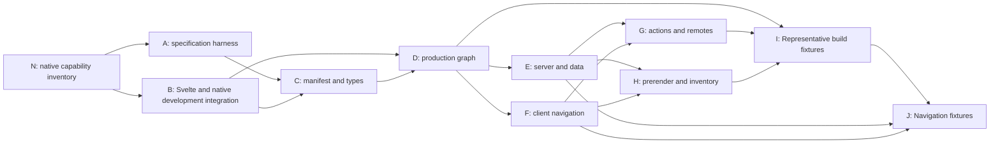

# Velveteen: Bun-native Svelte application framework

Investigation date: November 17, 2026; batches I and J accepted November 18. The user chose representative build and navigation fixtures inside Velveteen, using Interborough only as a read-only reference and leaving real-app adoption unaccepted. IF01–IF05 and JF01–JF06 now pass. `bun run test:batch-j` passes 271 Bun test executions, all 64 runtime comparisons and the complete earlier regression gate. J proves encoded addresses, query retention, history/redirects, leave guards, opt-in retained views, stale-load handling and bounded missing-chunk recovery. Both Corvidae checkouts match their recorded baseline. See [the execution record](./EXECUTION.md) for exact source identities, files changed and evidence. Publication and a Corvidae dependency remain outside this prototype milestone.

The fixture prototype is accepted through Batch Z. The latest full regression passed 312 Bun test executions and 112 observations across 28 shared cases, with each case running on Velveteen and pinned Kit in development and production. The later batches added the TypeScript starter, automatic query batching, progressive remote forms, graph retirement, request tracing, and relocated artifact compression. See the [pinned inventory audit](./tests/inventory/README.md#batch-z-audit) for intentional differences and remaining coverage gaps.

The earlier disposable app experiment remains unaccepted: its full build exposed dependency warnings that the previous compiler discarded. A same-version control preserves that finding. No further Corvidae implementation or application gates run in this batch, and the canonical checkout remains unchanged. Fixture acceptance cannot substitute for the unresolved real-app build or adoption gates.

The agreed target is SvelteKit behavior with room to improve APIs: use its tests as a specification and record intentional differences. Drop-in source compatibility is not required. Interborough is the first adoption candidate, not the entire definition of success.

## Verdict

Start with a version-pinned inventory of Bun’s native primitives, then assign implementation only to demonstrated gaps. A TypeScript-first framework using Svelte’s compiler, Bun’s bundler and server, Bun’s test runner, and Playwright is technically credible. Replacing the whole SvelteKit experience is substantial framework engineering. Changing test imports and replacing a build command will not accomplish it.

The first-batch fixtures demonstrate TypeScript components and rune modules, Bun browser/server builds, external CSS, DOM-free SSR, and hydration in Chromium without recovery or browser warnings/errors. Native `server.reload()` passes handler, route replacement, in-flight request, and streaming probes. Experimental `Bun.ModuleGraph` also passes the separate buffered-SSR lifecycle fixture with explicit application cleanup and request draining. A custom server supervisor remains outside the default architecture.

Batch C now provides deterministic file routing, one canonical manifest, a browser projection without server implementation paths, and generated route/load/endpoint/Svelte types. Its 21 selected routing expectations agree with pinned Kit source, real Bun HTTP and Chromium. The generated consumer gate runs strict TypeScript and Svelte checking, rejects eight deliberate type errors, and checks create/rename/delete regeneration. Route conflicts identify both source files. This establishes the selected C contract; E/F supply the runtime load/navigation behavior described below. Full Kit conformance is not claimed.

Batch D now builds separate browser/server role graphs, lazy entries, route CSS, native hashed assets and canonical base-path URLs. Validated immutable generations publish through an atomic pointer; failed rebuilds preserve the prior generation. Asset routes compose with an existing Bun host. Actual archives start outside the workspace after application source removal, with Bun-only execution and no installed `node_modules`, and pass SSR, hydration, click, CSS/image and lazy-module browser checks at both root and `/app`. The D fixture retains its minimal rendering/bootstrap boundary; the E/F application fixtures exercise the framework runtime from those emitted graphs.

Batches E and F now provide nested server/universal loads, hooks and request context, typed events, scoped cookies and enhanced fetch, devalue serialization, streamed document/data responses, nested SSR and error handling, hydration, and browser navigation. Eleven shared fixtures pass against pinned Kit and Velveteen in development and production. They cover load reuse, preload/invalidation, retained layouts, SPA/no-client modes, history/scroll/focus, errors/redirects, deferred settlement/rejection and stale work. Focused tests prove credential isolation, cancellation, terminal malformed transport, leave guards and disposal/restart. Actual ModuleGraph generations hydrate A, publish B on the same listener, finish held A consistently, cancel streams and preserve B after a failed build. Native Bun primitives remain the host foundation; no custom supervisor was introduced.

Batch G now provides default/named form actions, native and enhanced submission, files and submitter overrides, typed validation failures, redirects/errors and post-action loads. Typed remote definitions run through existing hooks and request context, validate unknown input before handlers, enforce same-origin POST, share one rich-value protocol, and invalidate after successful commands. Browser tests prove private implementations stay out of output and disposed submissions cannot commit stale results. Four action cases extend the shared reference/candidate matrix. Velveteen deliberately enforces form CSRF checks in development as well as production; pinned Kit disables that check in development. The comparison asserts this recorded difference explicitly.

Batch H now evaluates inherited route options and prerenders static/dynamic entries, crawled links, HTML/data, endpoints, redirects and public assets into immutable output. Failed renders, invalid entries/options, unsafe paths, collisions and publication failures preserve the prior artifact. A copied artifact runs outside the workspace after deleting source. Actual Chromium tests verify two offline pages, interaction, CSS and public bytes, a changed worker version, cleanup limited to its own old cache, and a failed new installation preserving the active worker. Applications register native worker lifecycle handlers through an explicit synchronous initializer and own their cache policy. The additional route-option comparison brings the shared runtime matrix to sixteen cases per runtime/mode cell. Every one of the 2,658 inventoried test files and 195 package scripts has an explicit feature owner; ownership does not imply implementation or passing upstream tests.

The generated consumer gate runs 33 compiler/checker executions with 21 deliberate invalid cases, including action data, cookie path requirements and server-only APIs excluded from universal loads. Typed remote consumers add eight strict compiler executions with six causal negative controls. The shared runtime source ledger records API differences, including explicit host hooks and remote definitions, a Svelte navigation context, route-ID code preload, same-URL data negotiation and worker metadata. The [conformance harness documentation](./tests/conformance/README.md) describes those entrypoints and the measured Bun Request policy limitation. Full upstream parity, complete experimental Kit remote-function coverage, arbitrary application side-effect cleanup and general memory bounds remain unclaimed.

The direct Svelte plugin path resets component state on a CSS-only edit, including with inline maps disabled. Publishing separate generated JavaScript, CSS, and map files closes this gap: unchanged JavaScript is not rewritten, and Bun’s native HTML hot reload preserves component state and the document while applying CSS. Actual component/rune edits and malformed-source repair pass in isolated browser fixtures. The framework owns this compiler publication step; Bun owns the browser update transport.

Interborough already uses Bun, Svelte, TypeScript, Bun tests, and Playwright without SvelteKit. Its compiler and build infrastructure provide useful source and adoption evidence. A new framework must improve that existing arrangement while adding capabilities Interborough does not currently prove, especially SSR, data loading, forms, prerendering, and general-purpose navigation.

No speedup, resource saving, delivery date, or full compatibility claim is established by this investigation. Measure cold and warm builds, update latency, startup, memory, and browser output against pinned controls before making performance claims.

## Evidence and scope

| Source | Inspected revision or version | What it establishes |
| --- | --- | --- |
| SvelteKit repository | `a58e0a92c35dbeee161e96c733464dc7397e073a`; package `3.3.0` | Current source architecture and test organization; not a claim that every test passes |
| RedwoodSDK repository | `31445bb9df117e9afec793ae2998844ebdd96837`; package `1.7.5` | Current router, runtime, Vite integration, and realtime implementation |
| Corvidae | `721367ba220dc2384c83ee1c33b3a38bdf702e5b` | Interborough’s current implementation, inspected read-only |
| Executable probes | Bun `1.4.4`, Svelte `5.57.0`, `bun-plugin-svelte` `0.0.6`, Playwright `1.63.0`, macOS arm64 | Narrow observed build, hydration, reload, and test-runner behavior |
| Reload comparison | Same fixture, Svelte version, browser, and Bun runtime; Vite `8.3.3`, `@sveltejs/vite-plugin-svelte` `7.3.1` | CSS-only update behavior differs between the two integrations |
| Native primitive probes | Bun `1.4.4`; `bun-primitives.test.ts`, R01–R10 | Handler/route replacement, request and stream continuity, cancellation, graceful stop, module-cache limits, native forms/cookies/HTML/CSRF |
| Compatible declaration matrix | TypeScript `6.0.3`, `@types/bun`/`bun-types` `1.4.4`, `@types/node` `26.6.6` | Strict checking of the probe and dependency declarations passes with `skipLibCheck: false`; a negative type fixture fails |

The preliminary research used Svelte 5.57.0, matching the then-installed Interborough dependency. The first batch supersedes that compilation evidence with Svelte 5.57.1 on both the candidate and pinned Kit reference. Its complete runtime/declaration/browser matrix and evidence are in [EXECUTION.md](./EXECUTION.md). These are small conformance fixtures, not a claim that Kit’s entire suite passes.

The local Velveteen directory was initially empty and was not a Git repository. The investigation produced this report and the dependency-free native runtime probes in `bun-primitives.test.ts`. Research checkouts, disposable fixtures, type-check tooling, dependencies, and logs are under `/tmp/velveteen-research.dOZXlN`; they are not product dependencies. Current batch artifacts and evidence are recorded in [EXECUTION.md](./EXECUTION.md). Corvidae was read-only during both investigations. No Linear issues, pull requests, releases, or deployments were created.

## Start with the native capability inventory

The inventory is the first execution artifact. Each row records the pinned runtime/API, supported scope, official source, executable evidence or an explicit unverified assumption, the behavioral gap, its owner, and a reuse/build/out-of-scope classification. The reviewer rejects an infrastructure assignment that duplicates an available primitive without a failing contract probe. Documentation or an API’s presence establishes a candidate, not full conformance.

The initial inventory below uses [Bun’s Web API catalog](https://bun.com/docs/runtime/web-apis), [native API catalog](https://bun.com/docs/runtime/bun-apis), and the narrower references linked in each row. R01–R10 refer to [the executable native probes](/Users/stevekinney/Developer/velveteen/bun-primitives.test.ts), run with `bun test ./bun-primitives.test.ts`. P01–P10 below remain the framework feasibility tests; the two inventories have different subjects.

| Capability | Built-in foundation and current evidence | Reuse/build disposition and remaining owner |
| --- | --- | --- |
| HTTP transport and handler replacement | [`Bun.serve`, `routes`, `server.reload()`](https://bun.com/docs/runtime/http/server); R01/R02 verify same-listener replacement, route addition/removal and old/new request behavior | Reuse transport and reload. B owns publication ordering and fresh handler preparation, not a new listener or proxy supervisor |
| Request/response and URL contracts | `Request`, `Response`, `Headers`, `fetch`, `URL`, `URLSearchParams`; R01/R08 exercise them | Reuse directly. E owns context, load ordering, response policy and error handling |
| HTTP route dispatch | [Native parameters, wildcards and method handlers](https://bun.com/docs/runtime/http/routing); R01/R08 cover a small subset | C compiles compatible manifest entries to native routes; probe precedence, optional/rest routes and method semantics before adding any custom matching |
| File discovery and routing conventions | `Bun.Glob`; [`Bun.FileSystemRouter` supports Next.js pages-style routing only](https://bun.com/docs/runtime/file-system-router) | Use glob/file primitives for discovery. Kit’s `+page`, layouts, groups and typed manifest still belong to C; do not substitute Next.js routing or invent a generic scanner |
| Form bodies and binary data | `Request.formData()`, `FormData`, `Blob`, `File`; multipart form field parsing exercised by R08 | Reuse parsing. G owns validation, progressive form/action behavior and malformed/upload-boundary tests; file limits are not proved by R08 |
| Cookies | [`Bun.Cookie`, `Bun.CookieMap`, `BunRequest.cookies`](https://bun.com/docs/runtime/http/cookies); R08 verifies read/set and response propagation in native routes | Reuse parsing/serialization. E owns framework defaults and confirms propagation when handlers are embedded; automatic route integration does not prove arbitrary standalone `Request` behavior |
| Streams and cancellation | Web streams and abort signals; R05/R06 verify response continuity across reload and client-abort propagation to the incoming request | Reuse transport. E/F own stream serialization, cancellation propagation and stale-result handling; backpressure and cleanup under load remain probes |
| Shutdown | `server.stop()`; R07 verifies an admitted request drains | Reuse listener shutdown. B owns application resource disposal; open WebSocket behavior is a separate unverified lifecycle case |
| Server module reload | [Bun `--hot` resets its module registry and preserves globals](https://bun.com/docs/runtime/watch-mode); documented, not yet tested here. R03 proves `server.reload()` and an entry query suffix do not refresh transitive imports | B probes `--hot` first, then complete build/import/publication if needed. No default server-generation supervisor or assumption of bounded module retention |
| Isolated module state and disposal | Experimental [`Bun.ModuleGraph`](https://bun.com/docs/runtime/module-graph), present in Bun `1.4.4` and its declarations; documentation describes independent module registries and `dispose()`, but host/global resources can outlive a graph and disposed asynchronous work may never settle | P10 proves fresh transitive SSR state, failed-candidate cleanup, last-good publication, abort cleanup, ten edits, stale-publication rejection and graceful draining using explicit resource ownership. Reuse as the buffered-SSR prototype; streaming disposal and general memory bounds remain unproven |
| Compilation and browser updates | `Bun.build`, `Bun.Transpiler`, plugin hooks, HTML imports and client HMR; prior production/CSS probes plus R04’s tiny complete server bundle | B/D integrate Svelte, conditions, CSS and source maps. Reuse bundling and browser transport; resolve the actual CSS update gap |
| Files, assets and generated output | `Bun.file`, `Bun.write`, `Bun.Glob`, native static responses; R03/R04 use file I/O, Interborough supplies existing build-policy source | D verifies the output graph, base paths and atomic publication. Native file responses supply range/HEAD behavior; exact asset routes add measured method/cache/ETag policy. The selected transport uses identity encoding; compression negotiation is not certified |
| HTML rewriting and escaping | [`HTMLRewriter`](https://bun.com/docs/runtime/html-rewriter), `Bun.escapeHTML`; R09 verifies response transformation and text escaping | Reuse where applicable. E owns document assembly and hydration semantics; this is not evidence of sanitization or streaming flush timing |
| Crypto and CSRF tokens | Web Crypto, `Bun.CryptoHasher`, [`Bun.CSRF`](https://bun.com/docs/runtime/csrf); R10 checks matching session/secret acceptance and mismatched rejection | Reuse cryptographic operations. G owns request-origin/method/content-type policy, session binding and lifecycle; a token primitive does not replace Kit’s security contract |
| Realtime transport | [Native WebSocket client/server APIs](https://bun.com/docs/runtime/http/websockets); documented, no new transport probe yet | Reuse when a required behavior calls for it. Application subscriptions, replay, authorization and durable state are not supplied by a socket API and are not added to core scope |
| Isolation and process control | `Worker`, messaging APIs, `Bun.spawn`; API presence checked, lifecycle guarantees unverified | Use only for a named need. Retain Interborough’s demonstrated browser-build subprocess boundary; do not infer a need for isolated server processes from it |
| Test/type toolchain | `bun:test`, TypeScript, Svelte checking and Playwright; R01–R10 and the strict declaration matrix run successfully | A owns test orchestration and type gates. Keep Playwright as the behavioral oracle; another browser API’s existence does not justify replacing it |
| Storage and other application services | `bun:sqlite`, `Bun.SQL`, Redis and S3 APIs are documented; relevant runtime globals are present | Available to applications, outside core framework scope. No database/session/storage subsystem is assigned merely because a primitive exists |

### What the reload probe establishes

R01 replaces static route membership and the fallback on the same server URL and process. R02 holds request A while publishing B, observes B on a new request, then releases A and receives A’s response. R05 does the equivalent for an already-open streamed response. R06 propagates a client abort into `Request.signal`; R07 drains an admitted request with native graceful shutdown. These remove the need to implement a listener, an HTTP generation proxy, or ordinary request draining solely for those behaviors.

R03 is a limitation test: editing a dependency and importing the same entry again still serves the old value; adding a query suffix to the entry does not refresh the transitive dependency. R04 builds a complete tiny graph into a distinct output, imports it, and publishes its handler with `server.reload()`; the new dependency value appears and the old handler stays coherent. A deliberately invalid build is not published, and the previous handler keeps serving. Success-before-publication is our orchestration in that probe, not rollback supplied by `server.reload()`.

R04 does not prove Svelte SSR graph behavior, externalized dependency freshness, module-cache reclamation, application side-effect cleanup, or stability across many updates. Native `--hot` is the first candidate for those remaining questions because it owns module invalidation; unique bundle imports are a second candidate, not an approved permanent cache-busting strategy. A custom process supervisor may only be proposed after a documented native limitation blocks a named requirement, with a failing reproduction and a concrete alternative for the user to review.

### Verified TypeScript declaration combination

The probe passes strict TypeScript checking using `typescript@6.0.3`, `@types/bun@1.4.4` (which resolves `bun-types@1.4.4`), and `@types/node@26.6.6`, with `types: ["bun"]` and `skipLibCheck: false`. Pin all three development dependencies and verify the resolved lockfile, because `bun-types` declares a wildcard Node-type dependency. The Node declaration package is supporting Bun’s types; no Node executable is needed.

The initial check using Corvidae’s installed `@types/node@24.13.5` failed because Bun’s declarations reference `node:util.TextEncoderEncodeIntoResult` and augment canonical `node:tls` declarations that the older package does not provide in the expected form. Node 26’s declarations provide those names. The compatible combination passes without patched declarations, ambient shims or skipped library checks. A separate `string`-to-`number` negative fixture exits nonzero with TS2322, confirming that the compiler still checks types. This verifies the native probe; A must also verify the Svelte/compiler/type-generation matrix before the TypeScript-first framework gate passes. Corvidae’s dependencies were not changed.

## What Bun replaces—and what remains ours

Svelte is the compiler and component runtime. SvelteKit supplies application behavior around it. Vite supplies a development/build environment. Vitest supplies part of the test harness. Those are distinct responsibilities.

For this proposal, Bun-native means the shipped package, application development/build pipeline, and candidate test harness have no dependency on `vite`, `vitest`, `@vitest/*`, `@sveltejs/vite-plugin-svelte`, or `@sveltejs/kit`, including transitive execution dependencies. Their commands and JavaScript child processes run through Bun, with no required Node executable. Standard `node:` APIs implemented by Bun are allowed; native browser processes are also allowed. TypeScript/Svelte tooling and Playwright must be launched with Bun explicitly where their executable shebang would otherwise select Node.

The upstream reference harness lives under a separately installed, unpublished `tests/reference` boundary. Only that harness may install or execute the upstream Vite/Vitest/Node toolchain. It cannot be imported by product code or candidate fixtures and is excluded from the distributed package. `audit:dependencies` must check product dependency closure, emitted module provenance, package contents, and recorded subprocess commands; import-name searching alone is insufficient.



| Responsibility | Existing foundation | Work Velveteen must own | Assessment |
| --- | --- | --- | --- |
| TypeScript execution and transpilation | Bun | Typed public contracts, generated route/load/action types, diagnostics, scaffolding | Feasible; transpilation alone is insufficient |
| Svelte component and rune compilation | `svelte/compiler` and Bun plugin hooks | Client/server conditions, consistent compiler options, CSS handling, source maps, diagnostics | Basic path verified by probe |
| Production JavaScript/CSS/assets | `Bun.build` | Entry graph, manifests, lazy route chunks, base paths, asset discovery, atomic publication | Existing Interborough implementation is useful evidence |
| HTTP serving | `Bun.serve`, native routes, cookies, `Request`, `Response`, streams, file responses | Request context, Kit route mapping, response/security policy and application cancellation | Native mechanisms verified narrowly; framework semantics remain work |
| Development | Native server reload, `--hot`, HTML development server, HMR API, filesystem/process primitives | Fresh module preparation, CSS-only updates, route discovery, error recovery, source mapping, resource disposal | Reload transport verified; module lifecycle and Svelte integration remain uncertain |
| SSR and hydration | Svelte server rendering and browser hydration | Load ordering, serialization, document assembly, hydration data, request isolation | Small probe passes; complete application behavior unproven |
| Navigation | Browser History API and Svelte | Nested layouts, invalidation, races, preloading, scroll/focus, error boundaries, accessibility | Substantial framework work |
| Tests | `bun:test` and Playwright | Ported runner setup, fixture lifecycle, dev/build matrices, provenance and reporting | Feasible; not a mechanical global replacement |

### SvelteKit’s reusable boundary

The current [Kit manifest](https://github.com/sveltejs/kit/blob/a58e0a92c35dbeee161e96c733464dc7397e073a/packages/kit/package.json) declares Vite and the Svelte Vite plugin as peers. Its [Vite entry](https://github.com/sveltejs/kit/blob/a58e0a92c35dbeee161e96c733464dc7397e073a/packages/kit/src/exports/vite/index.js) coordinates configuration, aliases, conditions, generated modules, and compilation. The [development integration](https://github.com/sveltejs/kit/blob/a58e0a92c35dbeee161e96c733464dc7397e073a/packages/kit/src/exports/vite/dev/index.js) depends on Vite’s module runner, middleware, watchers, and update lifecycle. The [build integration](https://github.com/sveltejs/kit/blob/a58e0a92c35dbeee161e96c733464dc7397e073a/packages/kit/src/exports/vite/build/index.js) coordinates server/client/service-worker compilation, analysis, prerendering, and deployment output.

The [sync machinery](https://github.com/sveltejs/kit/blob/a58e0a92c35dbeee161e96c733464dc7397e073a/packages/kit/src/core/sync/sync.js), [manifest generation](https://github.com/sveltejs/kit/blob/a58e0a92c35dbeee161e96c733464dc7397e073a/packages/kit/src/core/generate_manifest/index.js), route utilities, server runtime, and client runtime offer algorithms and behavioral contracts worth reusing. They still depend on generated module and build contracts; they are not all independently importable libraries.

There is already an official [`@sveltejs/adapter-bun` 1.0.1](https://github.com/sveltejs/kit/blob/a58e0a92c35dbeee161e96c733464dc7397e073a/packages/adapter-bun/package.json). Its [implementation](https://github.com/sveltejs/kit/blob/a58e0a92c35dbeee161e96c733464dc7397e073a/packages/adapter-bun/index.js) consumes Kit’s build output, includes Vite build hooks, and can produce a Bun executable. It solves deployment to Bun, not the proposed removal of Vite.

Recommendation: create one TypeScript package, reuse Svelte unchanged, and selectively port well-tested Kit behavior into owned modules. Preserve source provenance when copying code. Avoid a Vite compatibility layer, importing Kit’s private implementation at runtime, or carrying the whole upstream monorepo into the product. A wholesale fork maximizes inherited coupling; an entirely fresh implementation of routing, serialization, cookies, and navigation discards useful hard-won behavior.

### Development risk confirmed by experiment

[Bun’s documented HMR API](https://bun.com/docs/bundler/hot-reloading) supports acceptance, disposal, and persistent module data, but lists incomplete invalidation, messaging, and pruning support. Its [full-stack development documentation](https://bun.com/docs/bundler/fullstack) also distinguishes HTML bundling from framework-provided SSR. Do not make an undocumented framework API a prerequisite.

The [official Svelte plugin source](https://github.com/oven-sh/bun/blob/bd0219ed6c76c8789e0bb6253c54cf1c24bd0056/packages/bun-plugin-svelte/src/index.ts) is a starting point, not proof of complete development parity. Its CSS hash depends on CSS content, and its source notes limitations around layered source maps. In our fixture, changing only a component style changed its generated class and reset component state. That source behavior is a plausible explanation; the comparison proves the symptom, not that one hash change alone fixes it.

[The Svelte Vite plugin FAQ](https://github.com/sveltejs/vite-plugin-svelte/blob/39f4ac4ea190a5f6d4fd36584a802726d573257d/docs/faq.md) explicitly distinguishes JavaScript updates, which reset local state, from CSS-only updates, which preserve it. Velveteen’s acceptance criteria should match that actual behavior. Preserving arbitrary local state across JavaScript edits would be a separate feature.

## Interborough as a reference and adoption candidate

The application is already a Bun-native Svelte SPA. Its [browser entry](/Users/stevekinney/Developer/corvidae/applications/interborough/src/main.ts:1) mounts Svelte; its [application component](/Users/stevekinney/Developer/corvidae/applications/interborough/src/app/app.svelte:1) initializes host configuration, principal resolution, the Weft client, and query state. It is not currently an SSR application.

Useful foundations and seams:

- The [Svelte compiler plugin](/Users/stevekinney/Developer/corvidae/testing/testing/src/svelte-plugin.ts:164) already compiles `.svelte` and `.svelte.ts` for client and server targets. A production application currently imports it from the testing package; an eventual extraction should give compiler ownership a production-appropriate home and update consumers directly.
- The [browser build](/Users/stevekinney/Developer/corvidae/applications/interborough/scripts/build.ts:99) already handles HTML entrypoints, CSS, splitting, hashed assets, WASM, and metafile provenance. Its staging/swap behavior protects the last successful build. Shiki selection is application policy and should remain there.
- The [build subprocess boundary](/Users/stevekinney/Developer/corvidae/applications/interborough/src/host/browser-build.ts:1) records a concrete resolution problem when bundling inside the watched host process. Preserve and test that boundary until an exact-version reproduction proves it unnecessary.
- The [typed route registry](/Users/stevekinney/Developer/corvidae/applications/interborough/src/app/routes.ts:11), [History API router](/Users/stevekinney/Developer/corvidae/applications/interborough/src/lib/router.svelte.ts:1), and [route outlet](/Users/stevekinney/Developer/corvidae/applications/interborough/src/app/shell/route-outlet.svelte:1) are the navigation adoption seams.
- The host maintains [shell route registration](/Users/stevekinney/Developer/corvidae/applications/interborough/src/host/host.ts:841) and [HTML fallback policy](/Users/stevekinney/Developer/corvidae/applications/interborough/src/host/shell-request.ts:37). A shared manifest could remove duplicate route knowledge, but must preserve API and asset 404 behavior.
- Current [development reload](/Users/stevekinney/Developer/corvidae/applications/interborough/src/host/dev-reload.ts:24) uses SSE to reload the whole page. It is not evidence of state-preserving HMR.

Use these build seams to shape representative Velveteen fixtures. The active prototype does not change or consume a package in Corvidae. Any later real-app build adoption must resolve its recorded warnings and pass its own gates while preserving its router. Navigation remains a subsequent batch after route, query, redirect, leave-guard, retained-view, plugin wildcard, loading, error and missing-chunk behaviors have matching tests. Do not run two competing browser routers or leave a compatibility wrapper behind.

Keep Interborough’s auth, engine/Bureau lifecycle, Weft protocols, plugin domain model, storage, and supervisor in Corvidae. Expose a normal request handler and manifest so the existing host can compose the framework. The standalone framework server must not require replacing that host. Interborough may remain in SPA mode; standalone conformance fixtures must prove SSR independently.

## RedwoodSDK ideas worth adopting

RedwoodSDK is also Vite-based, and its [package manifest](https://github.com/redwoodjs/sdk/blob/31445bb9df117e9afec793ae2998844ebdd96837/sdk/package.json) depends on React, React Server Components, Cloudflare tooling, and Vite integration. Treat it as a source of useful designs, not a second runtime to combine with Svelte.

| Idea | Proposed treatment | Required evidence |
| --- | --- | --- |
| Native web request/response contracts | Adopt; expose ordinary `Request`, `Response`, `URL`, `Headers`, and streams | A handler composes inside an existing `Bun.serve` host without a framework-owned listener |
| Ordered middleware and early-return handlers | Adopt the semantics for a typed request pipeline | Auth/context handlers run before every page, endpoint, action, and remote invocation; returning a response prevents later handlers from running |
| Composable routing and layout primitives | Use to keep the runtime independent of discovery conventions | One normalized route manifest drives server and client behavior; adding a discovery mechanism does not create another matcher |
| Server-driven mutations and invalidation | Reconcile with Kit’s load/action/remote-function behavior | One mutation lifecycle and serialization contract; no competing RPC protocols |
| Realtime UI integration | Keep native streaming/WebSocket composition available; consider framework-level subscriptions only as separately approved scope | Cancellation, authorization, reconnect, unsubscribe, and backpressure are tested before a subscription feature is claimed |
| React Server Components and `use server` transforms | Exclude from this Svelte framework | No React/RSC build or wire protocol dependency |
| Durable Objects, Cloudflare hibernation, database/auth products | Exclude from the Bun runtime contract | No Cloudflare runtime dependency; application infrastructure remains application-owned |

The useful request-ordering contract appears in Redwood’s [request-handling design](https://github.com/redwoodjs/sdk/blob/31445bb9df117e9afec793ae2998844ebdd96837/docs/architecture/requestHandling.md) and [router implementation](https://github.com/redwoodjs/sdk/blob/31445bb9df117e9afec793ae2998844ebdd96837/sdk/src/runtime/lib/router.ts). Its [realtime state design](https://github.com/redwoodjs/sdk/blob/31445bb9df117e9afec793ae2998844ebdd96837/docs/architecture/realtimeStateHook.md) relies on Durable Objects and CapnWeb; replacing that with an in-memory Bun map would not reproduce its semantics.

For the initial public authoring model, retain familiar SvelteKit-style file routing and load/action separation. Use a single typed internal manifest and an embeddable handler. Do not simultaneously invent a second public routing language merely to resemble Redwood. Interborough’s special route metadata should remain application data. These are proposal defaults for review, not additional decisions the user has already approved.

## TypeScript out of the box

Define this as an observable contract rather than an implementation language claim:

- Framework implementation, configuration, endpoint handlers, loads, actions, and generated declarations use TypeScript.
- Generated components use standard `<script lang="ts">`; rune modules use `.svelte.ts`. Preserve Svelte syntax rather than inventing implicit TypeScript parsing rules.
- A fresh project includes strict TypeScript configuration, Svelte checking, and scripts that work without manual setup.
- Route parameters, page/layout data, action results, and request-local context have inferred or generated types.
- Positive type fixtures compile; negative fixtures fail for the intended error. Type errors must not silently pass because Bun transpiles the program.
- Type generation updates on route creation, rename, and deletion, and is reproducible in a clean production build.

Svelte’s [TypeScript documentation](https://svelte.dev/docs/svelte/typescript) and [compiler API](https://svelte.dev/docs/svelte/svelte-compiler) support this approach. Keep TypeScript checking and `svelte-check` as explicit gates even where Bun offers execution-time checking; Svelte component and generated-route correctness need their own coverage.

## The upstream tests are a specification, not a single switch

The proposal to port tests is sound. The strongest barometer is preserved behavioral assertions against an independently identified specification. A green suite becomes misleading if its fixture setup changes what is tested, its assertions are weakened to fit the implementation, or unsupported cases disappear from the denominator.

At the inspected Kit revision, source enumeration found 78 tracked `packages/kit/src/**/*.spec.js` files, 12 top-level application fixture manifests under `packages/kit/test/apps`, six build-error spec files, and three prerendering fixture packages. These are inventory counts, not executed-test counts. Parameterized tests, shared suites, browser projects, and environment variants expand the runtime matrix.

Kit’s [unit configuration](https://github.com/sveltejs/kit/blob/a58e0a92c35dbeee161e96c733464dc7397e073a/packages/kit/vitest.kit.config.js) installs the Svelte Vite plugin, generated-module aliases, custom matchers, server tests, and browser-runtime tests. Its [basic fixture scripts](https://github.com/sveltejs/kit/blob/a58e0a92c35dbeee161e96c733464dc7397e073a/packages/kit/test/apps/basics/package.json) separately run browser and server tests in development and production. Merely converting `vitest` imports would miss those distinctions.

| Test layer | Destination | What must remain observable |
| --- | --- | --- |
| Pure algorithms and server utilities | `bun:test` | Original inputs, expected outputs, errors, parameterized cases |
| Stateful server runtime and request handling | Bun tests with isolated fixtures/processes where needed | Context isolation, cookies, redirects, errors, streams, cancellation, mutation security |
| Component and DOM behavior | Existing Svelte testing tools where appropriate, plus real-browser gates | Correct compilation conditions and cleanup; DOM emulation does not substitute for hydration/navigation evidence |
| Navigation and browser integration | Playwright, launched under Bun | Actual hydration, history, scroll/focus, forms, styles, lazy chunks, browser errors |
| Development and production fixture suites | Dedicated Bun fixture launcher | Different commands, artifacts, readiness signals, shutdown, and identical external assertions |
| Invalid builds and security boundaries | Spawned builds with exit and diagnostic checks | Private imports rejected, invalid routes fail, no secret data in emitted browser graphs |
| Type generation and type failures | TypeScript plus `svelte-check` | Correct inference, errors, incremental updates, and clean build results |
| Prerendering and deployment artifacts | Bun process/HTTP/filesystem tests | Concrete files, headers, base paths, redirects, startup, and asset serving |
| Vite/Vitest implementation tests | Classify explicitly; replace implementation-specific checks with behavior tests where relevant | No claim to support arbitrary Vite plugins or Vitest configuration |

Keep Playwright. Replacing Vitest does not require writing a browser automation framework. Interborough already launches Playwright with Bun.

### Conformance accounting

Create a machine-readable ledger keyed by upstream commit, source file, test identity, parameter case, and execution mode. Each entry records the intended behavior, ported test, status, and evidence. Use statuses for passed, failing, not yet implemented, intentional API difference, and upstream-tool-specific behavior. Unimplemented and failing behavior remains visible; it is not a skip-based success.

Freeze the upstream revision for each implementation batch. Keep the upstream reference harness outside the shipped framework dependency graph. It may retain Vite/Vitest to establish the reference behavior; product builds, product development, and candidate test commands must use the new Bun pipeline. Re-run the control when a port’s meaning is uncertain. Preserve required browser, JavaScript-enabled/disabled, development/production, and configuration variants from the [upstream fixture harness](https://github.com/sveltejs/kit/blob/a58e0a92c35dbeee161e96c733464dc7397e073a/packages/kit/test/utils.js); an initial Chromium slice must not be reported as coverage of other browsers.

The independent reviewer owns assertion integrity. Mechanical runner/import/API changes are reviewed separately from behavioral assertion changes. A declared API difference needs an equivalent behavioral test and a recorded rationale; a change that removes product behavior needs an explicit scope decision. Do not normalize meaningful headers, ordering, URLs, security checks, or rendered content merely to obtain a match.

Completion for a selected milestone requires every assigned behavior to pass in its required modes, no unexplained inventory loss, and negative controls that prove the harness fails when the relevant behavior is deliberately broken. Broad SvelteKit behavioral completion additionally requires the entire pinned inventory to be accounted for, every applicable behavior to pass, and every intentional difference to be explicitly accepted. Interborough adoption alone cannot satisfy that broader bar.

## Historical post-J behavioral audit

The verified baseline is a working vertical slice: Bun hosts the generated application, Svelte renders and hydrates it, and fixtures exercise navigation, loads, actions, remotes and static output. All 185 inputs from the accepted J run still match its source hashes. That run recorded 271 passing Bun test executions and 16 shared runtime cases across four runtime/mode cells. J adds 30 focused navigation tests, including Velveteen's application-owned chunk recovery and retained views. See [J acceptance evidence](./EXECUTION.md#j-acceptance-evidence).

A fresh inventory and reference identity check passed against Kit 3.3.0 at `a58e0a92c35dbeee161e96c733464dc7397e073a`. The ledger contains 149 executable test definitions, 2,509 support files and 195 package scripts. Its file statuses still say `reference-only`. Selected behavior evidence lives separately in `routing-cases.json` and `runtime-cases.json`. One upstream file can include both verified and unverified cases, and a shared case runs in multiple cells. These counts cannot produce a parity percentage. See [the inventory contract](./tests/inventory/README.md) and [the shared harness](./tests/conformance/README.md).

| Area | Verified today | Remaining gap and evidence |
| --- | --- | --- |
| Routing and types | Selected static, dynamic, grouped, optional and rest routes, single decoding and generated declarations | Kit layout resets fail during Velveteen discovery. Matcher and route escape syntax are explicitly rejected by `src/routing/grammar.ts`. Kit 3 matchers can transform a parameter into a number or bigint, so future matcher work also affects parameter types and serialized data. [Pinned matcher tests](./tests/reference/upstream/packages/kit/src/utils/routing.spec.js#L590) |
| Loads, hooks and errors | Nested loads, request context, cookies, fetch replay, error boundaries and deferred results | The selected matrix leaves custom transport hooks and tracing unverified. The Redwood-inspired ordered middleware contract still needs one fixture proving short-circuit behavior across pages, endpoints, actions and remotes. [Kit hooks fixture](./tests/reference/upstream/packages/kit/test/apps/basics/src/hooks.js#L52) |
| Navigation | Hydration, scroll/focus, preload, invalidation, guards, retention, history and stale work | Kit shallow state and snapshots need their own cases. J's `keepView` still performs navigation and data loading. Route announcement also lacks a selected browser gate. [Pinned client tests](./tests/reference/upstream/packages/kit/test/apps/basics/test/playwright/client.test.js#L1440) |
| Actions and remotes | Native and enhanced forms, file submission, validation, redirects and explicit typed remotes | File size limits remain unverified. Kit's remote form, batching and query behaviors need individual dispositions against Velveteen's host-defined API. The development CSRF difference is already measured in both modes. [Selected runtime cases](./tests/inventory/runtime-cases.json) |
| Build, lifecycle and deployment | Native build and publication, copied artifacts, installed compiler consumer, held work across reload, and offline service worker updates | Retired graph disposal for a stream still in progress, backpressure and long-run memory bounds are separate tests. Compression negotiation, other deployment targets and performance claims lack fixture evidence. [Application publication test](./tests/lifecycle/application-publication.test.ts) |
| TypeScript project setup | Strict framework and fixture checking, generated route types, negative controls and installed compiler usage | The fresh-project promise still needs an empty-directory fixture that creates a complete app and passes install, check, development and production startup. Request locals currently use `Record<string, unknown>`, so application-specific local inference is also open. [Server event contract](./src/server/types.ts#L26) |

### Proposed batch K — Layout inheritance

Batch K was accepted on November 19, 2026. All four pinned Kit and Velveteen mode comparisons passed, followed by the complete Batch J regression gate. [Batch K acceptance](./EXECUTION.md#accepted-batch-k-layout-inheritance)

Implement layout resets in Velveteen fixtures. Kit lets pages and layouts select a named ancestor or the root. The reset changes which layouts render and which parent data a load can read. This is a good next test of the existing architecture because Velveteen currently derives branches from physical ancestry, and generated types walk that ancestry separately. The accepted baseline rejects Kit's valid `nested-layout/reset/+layout@.svelte` and `named-layouts/b/c/c2/+page@.svelte` fixtures as unsupported roles. It also rejects `+page@missing.svelte` at the generic role check, before it can identify the missing ancestor. [Kit's layout reset rules](https://svelte.dev/docs/kit/advanced-routing#breaking-out-of-layouts)

Start with the fixture worker and implementation worker in parallel. The fixture worker owns the pinned case map and reference/candidate observations in `tests/conformance` and `tests/inventory`. The implementation worker owns route discovery, parent resolution, the manifest in `src/routing` and focused routing tests. First agree on how the manifest distinguishes physical directories from the effective layout and error branch. The coordinator then traces the resolved branch through generated types, server loads/options, client rendering and build asset selection, changing only consumers that diverge. An independent reviewer checks the exact assertions and the source provenance.

| Gate | Acceptance | Verification |
| --- | --- | --- |
| K01 | Root reset and named ancestor reset resolve to the pinned Kit branch. Include a named group and a child whose layout resets its parent. Missing targets, reset syntax on load modules and duplicate component roles fail with source-located diagnostics. Use the pinned manifest tests for named layouts, missing layouts and invalid named references. | `bun run test:routing` |
| K02 | The shared `K-layout-inheritance` fixture passes against pinned Kit and actual Velveteen builds in both modes. On direct SSR and client navigation, the expected parent layouts, literal `parent()` data and route options agree. A skipped layout is absent and its load never runs. A failing child selects the same visible error boundary. Include a sibling with ordinary inheritance as the control. Base the root case on Kit's pinned browser test `resets layout`. | `bun run test:conformance -- --mode=development --case=K-layout-inheritance` and `bun run test:conformance -- --mode=production --case=K-layout-inheritance` after registering the case |
| K03 | Generated types accept access to retained ancestor data and reject access to skipped data for the intended diagnostic. Renaming the reset component changes both the generated contract and observed branch, with no stale generated file. | `bun run test:types` and `bun run typecheck` |
| K04 | Record source hashes, case dispositions and mode results. A negative control substitutes ordinary inheritance for the valid reset fixture and fails the literal branch assertion. The restored case and complete regression chain pass. | `bun run test:runtime-controls`, `bun run test:inventory` and `bun run test:batch-j` |

Reference tests live in [Kit's pinned manifest suite](./tests/reference/upstream/packages/kit/src/core/sync/create_manifest_data/index.spec.js#L853) and [browser suite](./tests/reference/upstream/packages/kit/test/apps/basics/test/playwright/test.js#L701). Run the reference cases before changing the implementation and retain their literal expectations. If a reference control fails or server, browser and type consumers disagree on the branch, record the failing case and stop acceptance at that boundary. K stays inside Velveteen fixtures. Matchers, shallow state, scaffolding and real application adoption remain separate scopes.

### Batch L — Typed parameter matchers

Batch L was accepted November 19, 2026. The four pinned Kit and Velveteen mode comparisons and the complete Batch J regression gate passed. [Batch L acceptance](./EXECUTION.md#accepted-batch-l-typed-parameter-matchers)

Use one public matcher module in the fixture, `src/params.ts`, with a named `params` export. Match required captures such as `[id=integer]` against decoded strings. An accepted value keeps its primitive type across server and browser consumers. Rejecting a value with `undefined` continues route selection. Static routes win before matched parameters, then unconstrained parameters. Unqualified routes retain string parameters. The fixture uses Kit's `defineParams` on the reference side and plain functions on the candidate side. This batch covers required matchers and leaves optional and rest-qualified matcher chains and schema authoring for separate work.

| Gate | Acceptance | Verification |
| --- | --- | --- |
| L01 | The canonical matcher selects static, matched and fallback routes in order. Rejected candidates fall through or return 404. Encoded captures decode once. Missing matcher definitions and unsupported returns produce diagnostics. Rebuilding observes updated definitions. | `bun run test:routing` |
| L02 | Pinned Kit and Velveteen select the same routes and preserve string, number, boolean and bigint values through direct HTTP, SSR, hydration and client navigation. Equal normalized captures reuse tracked loads. Changed captures rerun them. Removing an expected transform causes the literal fixture assertion to fail and restoration passes. | `bun run test:conformance -- --mode=development --case=L-typed-matchers`, the same command with `--mode=production`, and `bun run test:runtime-controls` |
| L03 | Generated route, page, layout, action and endpoint consumers agree with matcher return types. A numeric route rejects a string assignment, and shared layout types accept both matched and fallback values. Prerender preserves the accepted bigint, rejects an invalid entry and retains the last artifact. Browser compilation rejects a matcher dependency on a server-only module. | `bun run test:types`, `bun run test:prerender` and `bun run test:build-errors` |
| L04 | Independent review clears and the complete J chain passes with the new case and pinned source identities. | `bun run test:batch-j` |

### Batch M — Optional and rest-qualified matchers

Batch M was accepted November 19, 2026. Both builds of the Velveteen fixture matched pinned Kit, and the full Batch J regression gate passed. [Batch M acceptance](./EXECUTION.md#accepted-batch-m-optional-and-rest-qualified-matchers)

Extend the canonical matcher to cover `[[section=integer]]` and `[...path=path]`. Use pinned Kit 3.3.0 to verify when a rejected optional capture can be consumed by a later parameter. A rest matcher receives an empty string when the path contributes no segments. Continue to use the synchronous primitive matcher contract from L.

| Gate | Acceptance | Verification |
| --- | --- | --- |
| M01 | Pinned cases agree on optional omission, capture reassignment across chains, rest matching before a suffix, single decoding, and precedence when a matcher rejects. | `bun run test:routing` |
| M02 | The shared case proves literal capture ownership and empty-rest acceptance and rejection across direct HTTP, hydration and client navigation in both modes. A negative control drops a reassigned segment and fails the literal rest assertion. Restoration passes. | `bun run test:conformance -- --mode=development --case=M-optional-rest-matchers`, the same command with `--mode=production`, and `bun run test:runtime-controls` |
| M03 | Route declarations mark matched optional parameters as optional and preserve the accepted rest type. Structured prerender entries resolve to the named route with the intended capture ownership. Rejected or reassigned entries preserve the previous artifact. | `bun run test:types` and `bun run test:prerender` |
| M04 | Independent review and the full regression chain pass on the recorded sources. | `bun run test:batch-j` |

### Batch O — Shallow routing and snapshots

Batch O was accepted November 19, 2026. Both features matched pinned Kit in development and production, and the full Batch J gate passed. [Batch O acceptance](./EXECUTION.md#accepted-batch-o-shallow-routing-and-snapshots)

Prove entry-scoped navigation state and component snapshots in Velveteen fixtures. The shallow routing worker owns browser history, navigation, and its comparative fixture. The snapshot worker prepares its pinned fixture in parallel and integrates capture and restore after the shallow routing comparison passes. The coordinator owns harness registration and acceptance. An independent reviewer checks the integrated history and browser evidence.

| Gate | Acceptance | Verification |
| --- | --- | --- |
| O01 | Shallow push and relative replace update the address and entry state while preserving the mounted view and skipping loads. Back and forward restore the corresponding state. Hooks expose the shallow target, cancellation preserves the current entry for `goto` and popstate, relative invalidation refreshes the rendered route, and ordinary navigation exits shallow context. | `bun run test:conformance -- --mode=development --case=O-shallow-routing` and the same command with `--mode=production` |
| O02 | Explicit snapshots distinguish two shallow entries of one mounted view. Normal back and same-tab reload restore after navigation hooks. Branching from an older entry drops the abandoned snapshot. | `bun run test:conformance -- --mode=development --case=O-snapshots` and the same command with `--mode=production` |
| O03 | The runtime ledger identifies pinned source cases and a corrupt restore fails its literal assertion. The restored production candidate passes. | `bun run test:runtime-controls` |
| O04 | Independent review clears and the full regression chain passes on the recorded sources. | `bun run test:batch-j` |

### Batch P — Accessible route announcements

Batch P was accepted November 19, 2026. The route announcement case matched pinned Kit in both modes, the stale-title control failed as intended, and the full Batch J gate passed. [Batch P acceptance](./EXECUTION.md#accepted-batch-p-accessible-route-announcements)

Use a Velveteen fixture with two titled pages and an untitled page. The runtime worker owns the live region and its navigation lifecycle. The fixture worker owns the comparative case. The coordinator owns the pinned ledger, negative control and gates. Independent review checks the runtime and the browser assertions.

| Gate | Acceptance | Verification |
| --- | --- | --- |
| P01 | The hydrated root has one initially empty, visually hidden live region. Client links and Back announce the settled title. An untitled page announces the pinned fallback. A shallow transition has the same live-region behavior as pinned Kit. | `bun run test:conformance -- --mode=development --case=P-route-announcements` and the same command with `--mode=production` |
| P02 | A JavaScript-disabled browser follows server-rendered links and updates the page title without injecting a live region. The stale-title control fails at the announced destination title and the restored production fixture passes. | The P01 commands and `bun run test:runtime-controls` |
| P03 | Independent review clears and the full regression chain passes on the recorded sources. | `bun run test:batch-j` |

### Batch Q — Custom data transport

Batch Q was accepted November 19, 2026. Page transport passed before snapshot integration. Both matched pinned Kit in development and production, and the plain-object control and full Batch J gate passed. [Batch Q acceptance](./EXECUTION.md#accepted-batch-q-custom-data-transport)

Use one application-defined class in Velveteen fixtures. The page runtime worker owns the shared transport definition and the SSR, hydration and client data paths. The fixture worker prepares both comparisons in parallel. Integrate snapshots after the page comparison passes in both modes. The coordinator owns the harness and acceptance, and an independent reviewer checks the integration.

| Gate | Acceptance | Verification |
| --- | --- | --- |
| Q01 | A fixture class with private state survives SSR and hydration, client-side navigation, and a deferred settlement as a usable instance. | `bun run test:conformance -- --mode=development --case=Q-custom-transport` and the same command with `--mode=production` |
| Q02 | An explicit component snapshot uses the same transport definition and restores its changed instance after `afterNavigate` on same-tab reload. | `bun run test:conformance -- --mode=development --case=Q-transport-snapshots` and the same command with `--mode=production` |
| Q03 | A decoder returning a plain object with the same fields fails the unchanged instance assertion. The restored candidate passes. | `bun run test:runtime-controls` |
| Q04 | Independent review clears and the full regression chain passes on the recorded sources. | `bun run test:batch-j` |

### Batch R — Escaped route filenames

Batch R passed its focused gates, independent review and the full Batch J regression. [Batch R acceptance](./EXECUTION.md#accepted-batch-r-escaped-route-filenames)

Implement escaped literal tokens in the route grammar, then use the same meaning for precedence, structured prerender entries and generated parameter types. Prove the result with Velveteen fixtures and pinned Kit 3.3.0.

The user chose literal precedence for escaped filenames. The fixture checks the intentional difference where pinned Kit selects `[value]` for `😀` and Velveteen selects the escaped literal `[u+1f600]`.

| Gate | Acceptance | Verification |
| --- | --- | --- |
| R-route-parser | Hexadecimal and Unicode escapes match the pinned cases, preserve actual captures and produce source-located diagnostics for invalid tokens. | `bun run test:routing` |
| R-route-fixtures | Direct HTTP and same-document links select the expected escaped routes in both modes. A double-encoded link fails the unchanged route-selection assertion. | `bun run test:conformance -- --mode=development --case=R-route-escapes`, the same command with `--mode=production`, and `bun run test:runtime-controls` |
| R-static-and-types | Structured entries serve the correct encoded artifact, and the generated contract accepts actual parameters and rejects escape tokens as parameters. | `bun run test:prerender` and `bun run test:types` |

### Prototype batches S through Z

Accept R before S, then prioritize the empty-directory TypeScript experience in T. Continue through Z using the same fixture boundary and independent review. Each implementation batch runs its focused gates and the full `bun run test:batch-j` chain after the candidate stabilizes.

| Batch | Acceptance | Focused verification |
| --- | --- | --- |
| S | Ordered middleware can short-circuit page, endpoint, action and remote requests. Application locals are inferred and concurrent requests are isolated. [Accepted](./EXECUTION.md#accepted-batch-s-ordered-middleware-and-typed-locals) | `bun run test:server`, `bun run test:actions`, `bun run test:remote`, `bun run test:types` |
| T | The local create command generates a complete TypeScript app into an empty directory. That app installs, passes strict checks and starts in both modes through its own scripts. [Accepted](./EXECUTION.md#accepted-batch-t-typescript-starter) | `bun run test:package-consumer`, `bun run test:types` |
| U | Native and enhanced submissions round-trip custom results. A configured upload limit permits the boundary value and rejects an oversized request before application action execution. [Accepted](./EXECUTION.md#accepted-batch-u-action-transport-and-upload-limits) | `bun run test:actions`, `bun run test:server`, `bun run test:runtime-controls` |
| V | Cached queries deduplicate and batch automatically, a command refreshes cached values in its own response, and dedicated remote forms submit with or without JavaScript. [Selected scope](#batch-v-automatic-remote-behavior) · [Accepted](./EXECUTION.md#accepted-batch-v-automatic-remote-behavior) | `bun run test:remote`, `bun run test:types`, `bun run test:runtime-controls` |
| W | Retired graphs retain admitted streams and release resources after drain or cancellation. Repeated reloads prove bounded resource ownership and backpressure. [Accepted](./EXECUTION.md#accepted-batch-w-retired-graph-lifetime) | `bun run test:runtime-lifecycle`, `bun run test:development` |
| X | A request, its loads and a mutation emit correlated spans with observable failure and cancellation outcomes. [Accepted](./EXECUTION.md#accepted-batch-x-request-tracing) | `bun run test:server`, `bun run test:actions` |
| Y | A copied Bun production artifact starts independently and its responses negotiate compression correctly. [Accepted](./EXECUTION.md#accepted-batch-y-relocated-artifact-compression) | `bun run test:package`, `bun run audit:production`, `bun run test:prerender` |
| Z | Reconcile pinned inventory with exact executed cases, explicit differences and unverified browser or configuration variants. Publish the audit in the repository. [Accepted](./EXECUTION.md#accepted-batch-z-pinned-inventory-audit) | `bun run test:inventory`, `bun run test:runtime-controls`, `bun run test:batch-j` |

### Batch V automatic remote behavior

The user selected automatic behavior for the prototype. Velveteen keeps its explicit typed registries and shares the existing request context, devalue transport and form action lifecycle. The acceptance boundary is the behavior below in local Velveteen fixtures.

| Work | Owner and dependency | Acceptance | Verification |
| --- | --- | --- | --- |
| Cached queries, batching and refresh | Query worker owns `src/remote/client.ts`, remote protocol and query dispatch, with focused runtime/type tests. | Repeated reads reuse one cache entry. Distinct queries scheduled in one browser turn send one request. A batch resolver sees validated inputs once, and a per-entry error leaves other entries usable. A command updates a cached query in its own response, and an older in-flight response cannot replace the refreshed value. | `bun run test:remote` and `bun run test:types` |
| Progressive remote forms | Form worker owns the remote form registry and page-request integration, with focused action tests. The query wire and form registry can be implemented in parallel. | A registered remote form validates and handles a native or enhanced submission with the existing same-origin checks and request context. Native submission renders the result with JavaScript disabled. Enhanced submission retains the document. The form preserves the ordinary URL query and exposes validation errors. | `bun run test:actions`, `bun run test:server` and `bun run test:types` |
| Pinned comparison and integration | The coordinator owns the Velveteen fixtures and source ledger after both runtime contracts settle. Independent review follows the focused checks. | Both modes execute comparisons for pinned query batching, command refresh and progressive form behavior. Splitting the candidate batch fails the unchanged network-count assertion. Restoring batching passes. Batch J runs on the integrated candidate. | `bun run test:conformance -- --mode=development --case=V-query-batching` and `--case=V-progressive-forms`, repeat in production, then `bun run test:runtime-controls` and `bun run test:batch-j` |

## Proposed team and execution graph

Use one coordinator, at most two implementation workers, and one continuing read-only primary reviewer. Keep workers one level deep. Workers own cohesive behavior and its unit, integration, and browser tests; do not split “implementation” and “all tests” into permanently separate teams. That would make interfaces and failures somebody else’s problem.

The coordinator owns the dependency graph, shared contracts, integration, source pins, and one execution record. The reviewer checks conformance accounting, diff correctness, and the evidence for the exact candidate. Add a security specialist only for the named server/client boundary and mutation/serialization risks. Corvidae adoption follows its current host limits and repository instructions; avoid concurrent broad suites on the shared host.

The N through H commands below are implemented and verified. `bun run test:batch-gh` retains the combined N–H gate; `bun run test:batch-i` adds installed-consumer fixtures; `bun run test:batch-j` adds navigation fixtures and is the default `bun run test` gate. The native probe runs with `bun test ./bun-primitives.test.ts`. N accepts the capability inventory before framework implementation dispatch; A establishes shared scripts and pins. Workers inspect the resulting repository and match its conventions. I is the accepted build fixture prototype; J verifies representative navigation in Velveteen fixtures.

| Batch | Owner and owned surface | Dependencies | Binary acceptance and delivery artifact | Verification commands to establish |
| --- | --- | --- | --- | --- |
| N: Native capability inventory | One worker inventories/probes; coordinator owns dispositions; primary reviewer validates evidence | Plan revision | Every capability row has a source, pinned version, verified/assumed boundary, reuse/build/out-of-scope classification and owner; R01–R10 pass; the strict declaration combination passes its positive and negative controls; unverified lifecycle behavior is assigned to B as a probe, not promised as working infrastructure | `bun test ./bun-primitives.test.ts`; strict type-check commands in the execution record |
| A: Behavioral oracle and type/toolchain gates | Worker A: `tests/conformance`, source inventory, test launcher and type fixtures; coordinator owns root manifest/lockfile | N accepted | Pin the compatible declaration matrix plus Kit/Svelte/browser versions; record every upstream test family; reference/candidate fixtures match; negative controls fail; dependency audit separates reference tooling; Svelte/type generation checks retain strictness | `bun run test:inventory`; `bun run test:harness`; `bun run test:types`; `bun run audit:dependencies` |
| B: Svelte compilation and native development integration | Worker B: `src/compiler`, `src/development`, isolated fixtures | N accepted; interface changes synchronized with A | Reuse Bun bundling, HMR transport and handler reload; prove CSS-only updates, source maps and syntax recovery; test native `--hot` module lifecycle before any supervisor proposal; P04–P10 pass, including fresh SSR graphs and application resource disposal | `bun run test:compiler`; `bun run test:development`; `bun run test:production` |
| C: Kit route semantics and generated types | Routing worker: `src/routing`; types worker: `src/types`; coordinator: shared manifest and synchronization; continuing primary reviewer | A and B accepted | `Bun.Glob` discovery and native dispatch preserve selected static/dynamic/optional/rest/grouped route semantics and nested layout/error structure; custom matching requires a demonstrated native mismatch; one manifest drives both sides; generated types update after create/rename/delete; invalid routes/types fail | `bun run test:routing`; `bun run test:types`; `bun run typecheck` |
| D: Production graph and native serving integration | Graph worker: native bundler/asset correspondence and artifact audit; serving worker: publication/native transport and failure fixtures; coordinator: shared schema, graph integration, package/browser proof and gates; continuing primary reviewer | B and C accepted | Reuse `Bun.build`, file I/O and native responses; own output graph, route CSS, base paths and publication; failed build keeps last output; private/dev code stays out of browser output; clean packaged startup and existing-host composition pass; no new asset server without a contract gap | `bun run test:build`; `bun run test:production`; `bun run test:package`; `bun run audit:dependencies`; `bun run audit:production`; `bun run test:batch-d` |
| E: Rendering and application data lifecycle | Coordinator: shared data/orchestration/integration; server worker: response transport, fetch corrections and focused tests; independent primary/security reviewers | C and D | Reuse native requests, responses, cookies, HTML rewriting where suitable, streams and cancellation; own nested loads, hooks/context, serialization and document assembly; assigned fixtures pass, concurrent locals remain isolated and private imports fail in browser graphs | `bun run test:server`; `bun run test:security`; `bun run test:conformance -- --mode=production --group=server` |
| F: Browser navigation and hydration | Coordinator: navigation/Root/integration; browser worker: document/context and focused browser fixtures; continuing primary reviewer | C and D; E’s data protocol fixed before integration | SSR hydrates without warnings; SPA and no-client modes work; navigation, preload, invalidation, history, scroll/focus, nested errors and stale-navigation cancellation match fixtures; browser cleanup tests show no duplicate handlers/subscriptions | `bun run test:browser`; `bun run test:conformance -- --mode=development --group=navigation`; `bun run test:conformance -- --mode=production --group=navigation` |
| G: Action and remote-call semantics | Mutation worker: action/remote modules and focused tests; coordinator: protocol, server/client integration, generated types and shared oracle; continuing primary/security reviewers | E and F | Native/enhanced forms, errors, redirects, files and post-action loads pass; validation/auth/origin/CSRF/cancellation boundaries pass; typed remotes use one serializer and invalidate after commands; real compiler controls reject wrong calls/results | `bun run test:actions`; `bun run test:remote`; `bun run test:security`; `bun run test:types`; `bun run test:batch-gh` |
| H: Prerendering and remaining inventory | Static-output worker: options, prerender, worker packaging and focused fixtures; coordinator: static publication, copied-artifact browser proof and ownership controls; continuing primary/security reviewers | E and F | Inherited options, dynamic entries/crawl, output and failure preservation pass; copied source-free artifacts work offline and update safely; all source-ledger entries have owners without inflating completion | `bun run test:prerender`; `bun run test:build-errors`; `bun run test:conformance`; `bun run test:inventory`; `bun run test:batch-gh` |
| I: Representative build fixtures | One worker in Velveteen’s existing installed-consumer fixtures; continuing primary reviewer | D and G/H accepted; packed compiler identity | Prove native HTML builds in development/production, typed rune interaction and CSS, lazy hashed assets, source-map policy and application-owned resolver/WASM plugins; retain SSR/runtime imports and strict failure-preservation gates | IF01–IF05 in the execution record; `bun run test:batch-i`; real-app adoption remains unaccepted |
| J: Representative navigation fixtures | Address worker: URL/query/plugin fixtures; lifecycle worker: client identity and lifecycle fixtures; continuing reviewer | I, E and F accepted; Interborough remains read-only | Real development/production navigation proves query state, encoded IDs, plugin rest routes, redirects/history, guards, retained views, loading/faults and bounded chunk recovery; no Corvidae change or adoption claim | JF01–JF06 in the execution record; `bun run test:navigation`; `bun run test:batch-j` |



C completes and is accepted before D starts, including its manifest interface. E and F can overlap after the coordinator and both workers record the data/serialization contract in a shared TypeScript contract file; changing it reopens affected tests on both sides. G and H ran in parallel and are accepted. The user required their gates before I; that prerequisite is now satisfied. I consumes one worker slot for fixtures inside Velveteen and requires no Corvidae dependency. Passing I does not accept the failed real-app experiment. The user authorized J as representative navigation fixtures, so real-app build adoption is not a prerequisite. Both Corvidae checkouts remain unchanged; application adoption still requires its own unresolved build and navigation gates.

B tested Bun’s documented `--hot` module invalidation before choosing a lifecycle mechanism. The retained raw probe fails: its admitted A request remains unsettled and retired callbacks survive. The native `ModuleGraph` alternative passes P10 when application cleanup and request draining precede disposal. Preserve both reproductions when changing Bun versions. If it fails a named contract, evaluate complete bundled generations with `server.reload()` using the same fixture, including module retention and externalized dependencies. Neither a query-string import nor the small R04 bundle proof satisfies this gate by itself. A server-process supervisor has no assigned implementation owner; it requires a failing native reproduction and an explicit architecture decision after reviewing alternatives. Browser builds retain Interborough’s separate, demonstrated subprocess boundary; B must stop and await any build children it owns.

The B fixture holds one request open on handler generation A, edits a transitive server-rendered source value, waits for a successful B publication, and verifies that a new document request and a fresh fetch from an already-open browser observe B on the same listener. Releasing the first request must return A consistently. A syntax failure or candidate initialization failure must preserve B and clean up candidate-owned resources. An aborted request must release its subscriptions. A counter/event-registration fixture over ten distinct edits must observe exactly one current-generation callback per event and zero callbacks from retired generations. Out-of-order build completion must not publish an older generation over a newer one. Repeated updates must use a documented module-registry reset/unload lifecycle, exercised by a module-scope initializer that sees each edited value. Importing a new persistent URL for every edit without such a lifecycle fails the gate; a small number of successful responses is not a memory-retention guarantee. Native shutdown must drain admitted requests and dispose owned application resources. E/F later add the real load/navigation protocol to this fixture. B tests simple entry discovery; C owns full route grammar and type regeneration.

Do not dispatch all batches immediately. Accept N first, then run A and B. Reuse the native evidence recorded here when its versions and source identity are unchanged. Their remaining probes determine whether native composition supplies the complete development contract. If CSS-only updates, SSR invalidation, source mapping, retention or error recovery cannot be achieved with supported Bun/compiler interfaces, return the exact failing criterion and evidence. Do not quietly accept page reloads as HMR parity or introduce Vite behind a renamed command.

### Batch C contract and synchronization point

C uses two implementation workers and the continuing primary reviewer. The routing worker owns native HTTP probes, the selected route grammar, deterministic `Bun.Glob` discovery, precedence/conflict diagnostics and browser-safe matching. The types worker consumes the shared manifest and owns generated declarations plus real TypeScript/Svelte consumer checks. The coordinator owns `src/routing/manifest-types.ts`, file-watch synchronization, shared scripts and integrated verification. Workers cannot change the shared contract independently or delegate further.

The selected grammar includes static, dynamic, embedded dynamic, optional, rest (empty and nonterminal), and grouped routes. Every physical ancestor is represented, including layout-only directories. Page, layout, error and endpoint sources retain distinct roles; inherited layout/error arrays align with the ancestor chain. The browser projection removes server module paths and the absolute source root. Unsupported matchers, layout resets and other unselected syntax fail explicitly; they are not reported as passed upstream cases. Load execution, action/remote semantics, navigation and production graph construction remain outside C.

The binary C01–C07 criteria and commands are recorded in [the current execution record](./EXECUTION.md). Native routing mismatches must be reproduced before custom matching is accepted. Selected upstream cases keep their revision, test identity and expected result. Generated types must pass actual strict TypeScript and Svelte checks; incorrect route IDs, parameters, data and endpoint returns must each fail for the intended reason. Filesystem create/rename/delete tests must update routing and generated declarations on the same listener, preserve unrelated declarations, retain the last good publication after an invalid route and stop their watchers cleanly.

`bun run test:batch-c` passed on November 17, 2026, with an unchanged source state recorded in [the batch result](./.velveteen/evidence/batch-c-result.json). It is the acceptance gate: C routing/types tests, the complete accepted N/A/B regression matrix, package/dependency auditing, formatting, lint and strict type checks. The continuing reviewer cleared the correctness and assertion-integrity findings before that final execution. Its source digest is `4ea3964d1a8190bc9c22b7444059478a5e2ee44963416d486d5bc14022d189cb`; [the full log](./.velveteen/evidence/batch-c.log) records the passing commands. D is now unblocked by C; this batch does not implement D.

### Initial A/B fixture matrix and pass rule

The following IDs are the fixed first-batch acceptance inventory. A owns P01–P03, B owns P04–P10, and the reviewer checks both. P02 uses one minimal page and endpoint; it does not require implementing Kit’s entire router before the build feasibility gate.

| ID | Fixture and binary assertion | Command |
| --- | --- | --- |
| P01 | Inventory identifies every tracked upstream test file and executable package test/check script at the pinned revision, classifies its runner and modes, and fails when a known entry is removed without a recorded classification change | `bun run test:inventory` |
| P02 | Reference and candidate fixtures both serve `/proof` with status 200 and visible `Original: 0`, `/endpoint` with status 200 and JSON `{ "status": "ok" }`, and an unmatched non-HTML request with status 404; after hydration, clicking the button produces `Original: 1`; run against development and production outputs | `bun run test:harness` |
| P03 | Changing the candidate endpoint to `{ "status": "wrong" }` makes the harness exit nonzero; selecting no tests exits nonzero; adding a forbidden product dependency or Node child command makes the dependency/process audit exit nonzero; restored controls pass | `bun run test:harness`; `bun run audit:dependencies` |
| P04 | A typed `.svelte` component imports a `.svelte.ts` rune module; production browser and server builds succeed; CSS loads; DOM-free SSR includes the counter; hydration with recovery disabled succeeds, clicking updates the counter, and browser warnings/errors are absent | `bun run test:compiler`; `bun run test:production` |
| P05 | After clicking to `Original: 1`, changing only the style changes the computed color while preserving `Original: 1` and a document identity marker | `bun run test:development` |
| P06 | Editing the component label changes the visible text to `Updated: 0` without replacing the document, matching the Svelte/Vite control; editing the rune module’s increment from one to two makes a newly initialized counter advance from zero to two | `bun run test:development` |
| P07 | An intentionally malformed component produces a source-located compiler diagnostic; repairing it updates the mounted component without a manual refresh or document replacement; no unrelated browser error remains | `bun run test:development` |
| P08 | Intentional errors at known lines in a `.svelte` component and a `.svelte.ts` module map from generated browser stack locations back to those exact original files and lines, using the served source maps and original source contents | `bun run test:compiler`; `bun run test:production` |
| P09 | Adding a fixture entry makes its page available, renaming it removes the old entry and serves the new one, and deleting it returns 404; no server restart command or stale output is required | `bun run test:development` |
| P10 | The explicit native module/publication fixture above passes: new SSR requests see B, the held request returns A, failed candidates preserve B, aborts release resources, ten edits do not duplicate callbacks, stale builds cannot publish, a documented module-registry reset/unload lifecycle is exercised, and native shutdown plus owned build-child cleanup complete | `bun run test:development` |

N passes when every inventory row has the required evidence/classification/owner fields, R01–R10 pass, and the exact declaration matrix passes positive checking while rejecting the negative fixture. API presence alone cannot be labeled verified behavior. A/B cannot be dispatched before that inventory review. The A/B pass rule is conjunctive: P01–P10 pass, all shared formatting/lint/type gates pass, the reviewer has no unresolved correctness or assertion-integrity finding, and the execution record identifies exact revisions, versions, commands, exits, and logs. Any failed, missing, skipped, or unverified criterion blocks C and D. Report the failed ID and root-cause evidence to the user; an intentional change to this gate requires their decision. This is a feasibility decision boundary, not permission for a worker to weaken a test.

### Acceptance inventory for the first vertical slice

The first integrated fixture after C–F must have a nested layout, typed dynamic route, server load, endpoint, CSS and static asset, redirect, not-found/error path, client navigation, and SSR-to-browser hydration. A form fixture is added by G. Tests must exercise development and built output independently. A production-only fixture cannot certify the development server.

Include adversarial cases from the outset: two concurrent requests with different locals; an aborted navigation whose slow response arrives last; a rejected load; a failed rebuild; a deleted route; a transitive private import; and cleanup after a replaced server generation. These are small causal tests, not an invitation to build speculative infrastructure.

### Commands and delivery discipline

For Velveteen, batch A establishes `bun run format:check`, `bun run lint`, `bun run typecheck`, and the named test scripts using the verified declaration pins, explicit `types: ["bun"]`, and `skipLibCheck: false`. Include a negative type-control fixture so a toolchain update cannot silently disable checking. Each batch runs focused tests first, then review and corrections. Before accepting an integrated milestone, run its full applicable conformance matrix and package smoke test. A script with no selected tests must fail. Never use a green unit suite to stand in for missing browser, type, build, or artifact evidence.

These commands already exist in Corvidae and describe broader application qualification. For active batch I, use only the Velveteen fixture gates named in [the execution record](./EXECUTION.md); neither Corvidae checkout is changed or tested further. A later production adoption would establish the applicable application gates from this set:

```bash
bun run --filter=@lostgradient/interborough lint
bun run --filter=@lostgradient/interborough typecheck
bun run --filter=@lostgradient/interborough test
bun run --filter=@lostgradient/interborough test:slow
bun run --filter=@lostgradient/interborough build
bun run --filter=@lostgradient/interborough test:browser
```

The filters do not establish repository-wide health or validate every consumer of an extracted compiler. Inspect the final affected graph and run the required root/consumer checks under current Corvidae instructions. Use `with-turborepo-cache` whenever invoking its cache-dependent gates. Interface changes require Corvidae’s design capture and review. Release claims additionally require checking the actual installed/distributed Interborough artifact. The current investigation did not run these application suites.

Each worker receives a self-contained charter with revision, source pins, owned files, input/output contracts, exact commands, test-ledger entries, dependencies, and completion/failure signals. Workers may not delegate or change another owner’s interface unilaterally. They return candidate identity, commands and exits, evidence paths, and unresolved findings. After two unsuccessful fixes to one defect, reassess the cause and report the failing boundary; do not increase limits, suppress tests, or rename the task to restart the count.

The coordinator keeps one execution record with accepted decisions, candidate revisions, checks, integration status, and open blockers. Reuse evidence only for identical relevant code, dependencies, configuration, and environment. Keep one reviewer through corrections. Integrate one candidate at a time. Publication and consumer adoption are separate delivery boundaries; no release is implied by this proposal.

## Research execution record

Two read-only research agents examined Kit and Interborough; the coordinator inspected RedwoodSDK, current official documentation, and ran the disposable probes. No full upstream suite or Corvidae validation was executed. Shared-account token/cost telemetry was unavailable, so no cost figure is asserted.

Revision decision history: the user requested native capability inventory before implementation assignments and a `server.reload()` probe before choosing a supervisor. The native probes replaced that supervisor assumption with a demonstrated native handler boundary and a separately owned module-lifecycle question. When strict declaration checking exposed an incompatible Node-type version, the user explicitly extended this task to find and verify a compatible toolchain. The exact Node 26 declaration pin passes without suppression; the framework and Corvidae implementation boundaries remain unchanged.

Revision verification:

| Check | Result and evidence |
| --- | --- |
| `bun test ./bun-primitives.test.ts`, from Velveteen | R01–R10 pass on Bun 1.4.4; log `/tmp/velveteen-research.dOZXlN/bun-primitives.log` |
| Strict probe/declaration check using the command below | Exit 0 with TypeScript 6.0.3, Bun types 1.4.4 and Node types 26.6.6; `skipLibCheck` explicitly false; log `typecheck-bun-only.log` in the research directory |
| Same compiler/options against `typecheck/invalid.ts` in the research directory | Expected exit 2 with TS2322 for assigning a string to a number; log `typecheck-negative.log` |

The compatible toolchain was installed in the research directory with exact pins: `bun add --dev --exact typescript@6.0.3 @types/bun@1.4.4 @types/node@26.6.6 --ignore-scripts`. It does not install a Node runtime. To repeat the successful check from `/tmp/velveteen-research.dOZXlN`:

```bash
bun node_modules/typescript/bin/tsc --noEmit --strict --skipLibCheck false --target esnext --module preserve --moduleResolution bundler --types /tmp/velveteen-research.dOZXlN/node_modules/@types/bun /Users/stevekinney/Developer/velveteen/bun-primitives.test.ts
```

For the negative control, replace the final input path with `typecheck/invalid.ts`, whose contents are `const invalid: number = "type-check-must-reject"; export { invalid };`. Its nonzero exit is required. A owns turning this verified matrix and these controls into normal repository gates; it must verify the actual resolved versions after a frozen-lockfile install.

The earlier Svelte/framework research commands below ran from `/tmp/velveteen-research.dOZXlN`:

| Command | Exit/result | Evidence |
| --- | --- | --- |
| `NODE_ENV=production bun probe/probe.ts --production-only` | `0`; production build, external CSS, DOM-free server rendering, hydration with recovery disabled, interactive rune state and empty browser error/warning list passed | `production-probe.log` |
| `bun probe/hmr-comparison.ts` | `0`; comparison completed; Vite CSS edit retained `Original: 1`, Bun CSS edit produced `Original: 0`; both retained the document; both JavaScript edits produced `Updated: 0`; empty browser error/warning lists | `hmr-comparison.log` |
| `bun test probe/format.test.ts probe/escape.test.ts` | `0`; seven tests passed across two ported upstream utility spec files | `test-port.log` |

The test-port probe changed runner/assert imports and implementation import paths, preserving the original inputs and expected results. It ran against upstream utility implementations, not a new framework implementation. It proves that a small pure-test subset is portable; it does not establish general Vitest compatibility or Velveteen correctness.

Two initial failed probe runs remain recorded. The first exposed inconsistent client/server whitespace options in the probe configuration; aligning the options made production hydration pass without recovery. The second expected local state to survive a component JavaScript update, which the documented Svelte behavior and matching Vite control disproved. Neither failure was hidden by relaxing the production assertions. The separate CSS-only comparison establishes the actual integration gap.

Probe source SHA-256 values:

```text
probe/probe.ts: ec4a544fb1e0b84191e2a9f6b85466ddfbe5c40d8f559d72edf8cf7ae10efe84
probe/hmr-comparison.ts: 3afae235d5fa5bae6897f813cd560851f381f0b3e7f114a0bd522e021b9c04a3
probe/format.test.ts: 7d62165640f2a891914e605f207af60660f912d69a777218eb300b1a4fc472d2
probe/escape.test.ts: 21ef53eaf63f1a072c844edf7ebb8a0f3769ac37a720f29e7995d8b240b5ddde
```

These temporary paths are local evidence, not a durable test distribution. Batch A must capture accepted reproductions and provenance in the new repository before relying on them as project gates. Carry the upstream notices with copied code and tests; the inspected [Kit license](https://github.com/sveltejs/kit/blob/a58e0a92c35dbeee161e96c733464dc7397e073a/LICENSE) and [Redwood license](https://github.com/redwoodjs/sdk/blob/31445bb9df117e9afec793ae2998844ebdd96837/LICENSE.md) are MIT.

## Recommended authorization boundary

The user subsequently authorized the first batch: verify N, then run A for the behavioral oracle/type gates and B for Svelte/native lifecycle probes in parallel. N and P01–P10 passed independent review, and `bun run test:first-batch` exited 0. [EXECUTION.md](./EXECUTION.md) records the complete first-batch evidence, exact source identities and reproducible commands. Their deliverable is a reproducible go/no-go result and a small working fixture. A custom server supervisor is not part of the default assignment. Broader framework implementation, package publication, and Interborough changes follow only after the first implementation evidence is accepted. The overall mission remains the agreed SvelteKit behavior target.
